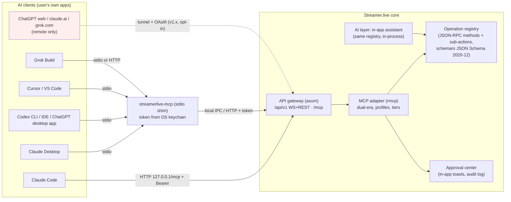
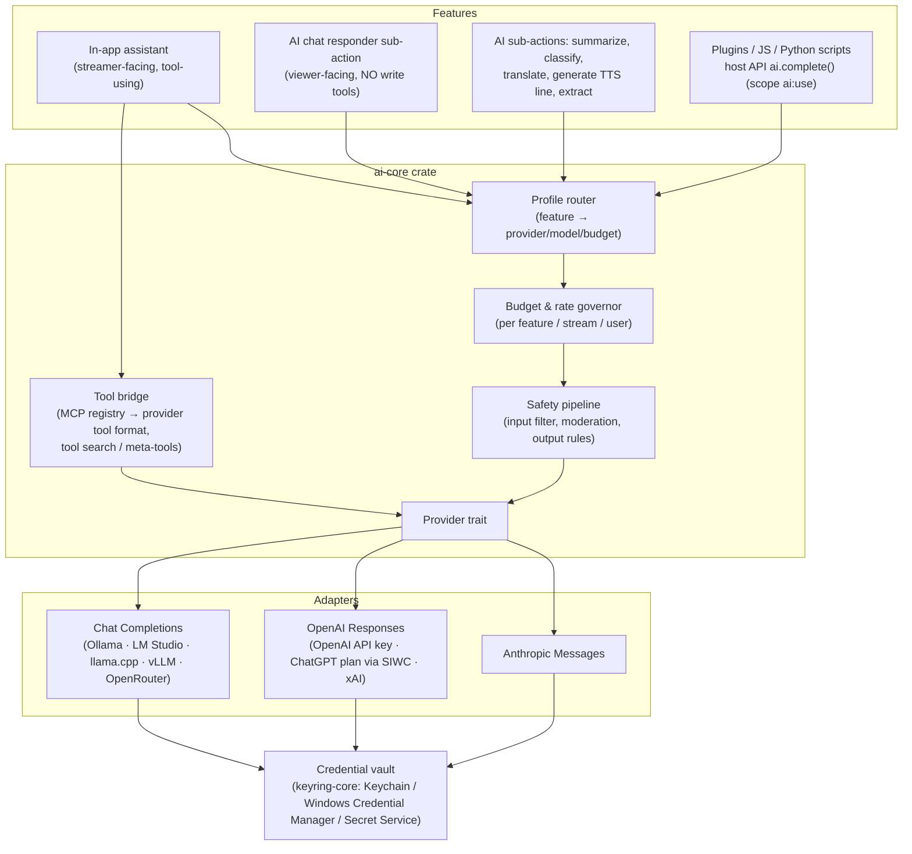

# MCP Server and AI Provider Integration (OpenAI, Anthropic, xAI)

*Research date: 2026-10-18. Scope: Streamer.live (Rust core + Tauri 2 + TypeScript UI, API-first: JSON-RPC over WebSocket plus REST, with schemas generated by schemars). This builds on [plugin-sdk-and-api.md](plugin-sdk-and-api.md) §A9 (MCP evaluation) and §B3 (API transports, `slt_` tokens, scopes, pairing). The spec-change summary from that doc is not repeated here.*

*Convention: every claim cites a source inline. "(unverified)" means I could not confirm it on an official page. Prices and model IDs were checked on vendor pages on 2026-10-18.*

---

## 0. TL;DR

1. **MCP server:** build it **dual-era**. Serve the stateless **2026-07-28** revision and the legacy **2025-11-25** `initialize` handshake, because client adoption is still mixed. Use `rmcp` 3.5.1 (the Rust SDK is now **Tier 1**). Offer two transports:
   - **Streamable HTTP** on `127.0.0.1` with scoped bearer tokens.
   - A **stdio shim** binary (`streamerlive-mcp`) that most local clients launch. With the shim, no secret ever goes into a third-party config file.
2. **500+ operations:** do not list them all as tools by default. Ship a small curated **core toolset** (about 20 tools) plus three **meta-tools**: `search_operations`, `describe_operation` and `invoke_operation`. This is the MCP-recommended catalog → inspect → execute pattern. An opt-in **"full" profile** lists every operation as a native tool, for clients that have their own tool search (Claude Code defers MCP tools by default). Tool lists vary by token, so each client gets its own profile.
3. **Safety:** risk tiers come from schema metadata, and every mutating operation supports `dryRun`. Destructive calls need **in-app approval**, delivered through an MRTR approval handle. MCP elicitation is a convenience, not a security boundary. A viewer-facing AI never gets write tools.
4. **Using consumer subscriptions in our app:**
   - **OpenAI** officially allows it through **Sign in with ChatGPT plan usage** for open-source or locally run apps. Paid or hosted apps need approval.
   - **Anthropic prohibits** offering Claude.ai login or routing requests through Pro/Max credentials.
   - **xAI** has no published third-party program. It has blessed specific open-source agents (OpenCode, Kilo Code), so this is gray.
   - **The universally compliant path:** the user's own vendor app (Claude Desktop, Claude Code, Codex, the ChatGPT desktop app, Grok Build, Cursor) connects **to our MCP server**.
5. **AI layer:** our own provider trait over three wire formats:
   - Anthropic Messages.
   - OpenAI Responses, which also covers xAI and the ChatGPT-plan route.
   - Chat Completions, for Ollama, LM Studio and llama.cpp.

   Plus: keys in the OS keychain (`keyring-core` 1.0); the in-app assistant reuses the MCP tool registry in-process; per-feature budgets; and a moderated, tool-less **AI chat responder** with AI disclosure on by default (EU AI Act Art. 50(1) has applied since 2026-08-02).

---

# Part 1: MCP server design

## 1.1 What changed since the prior doc (deltas only)

- **Rust SDK is Tier 1.** The official SDK table lists TypeScript, Python, C#, Go, **Rust** and Ruby as Tier 1 ([SDKs](https://modelcontextprotocol.io/docs/sdk)). `rmcp` 3.5.1 was released 2026-10-05 (crates.io). Its README says it "implements the stable MCP 2026-07-28 specification while remaining fully compatible with the 2025-11-25 release and earlier." It serves 2026-07-28 statelessly, with `with_legacy_session_mode(...)` for older versions. It ships `transport-io` (stdio), `transport-streamable-http-server` (a Tower service mounted on axum via `nest_service("/mcp", ...)`), `#[tool]`/`#[tool_router]` macros, elicitation, and the **Tasks extension** ([rust-sdk](https://github.com/modelcontextprotocol/rust-sdk)). Legacy HTTP+SSE is a "deliberate non-goal."
- **Dual-era is required in practice.** A modern-only server fails against legacy clients ("Legacy clients have no fall-forward mechanism"). The spec allows a dual-era server to serve both eras on one endpoint ([versioning](https://modelcontextprotocol.io/specification/2026-07-28/basic/versioning)). Claude Code, for example, still documents a legacy-negotiation escape hatch (`MCP_PROTOCOL_NEGOTIATION=legacy`) for channel servers ([Claude Code MCP](https://code.claude.com/docs/en/mcp)).
- **Streamable HTTP details we must implement** ([streamable-http](https://modelcontextprotocol.io/specification/2026-07-28/basic/transports/streamable-http)):
  - Validate `Origin` and return 403 when it is invalid. Bind to 127.0.0.1. Authenticate every connection.
  - Require the `MCP-Protocol-Version`, `Mcp-Method` and `Mcp-Name` headers, and validate that they match the body (error `-32020 HeaderMismatch`).
  - Return `405` for legacy GET/DELETE on modern-only paths.
  - Each request's SSE stream carries progress, and closing that stream cancels the request.
  - `subscriptions/listen` is the only long-lived stream. Send SSE keep-alive comments on it.
- **Cacheable lists.** `tools/list`, `resources/list`, `prompts/list` and `resources/read` must carry `ttlMs` and `cacheScope`. Tools should be returned in deterministic order, which also helps LLM prompt-cache hits ([changelog](https://modelcontextprotocol.io/specification/2026-07-28/changelog)).
- **Tool list may vary by credential.** `tools/list` "MAY vary by the authorization presented on the request — for example, returning only the tools the caller's granted scopes permit." It must not vary per connection ([tools](https://modelcontextprotocol.io/specification/2026-07-28/server/tools)). This is what makes per-client **toolset profiles** spec-legal.
- **State lives in handles.** There is no session. The spec's guidance is to return explicit server-minted handles as tool arguments, with entropy, a bounded lifetime and authorization checks ([tools: stateful tools](https://modelcontextprotocol.io/specification/2026-07-28/server/tools)). We use this for approvals, event cursors and draft actions.
- **Tool grouping is not standard yet.** An `io.modelcontextprotocol/groups` extension (`groups/list`, `groups/get`, with scoped tools left out of `tools/list`) is an **open draft** in the progressive-disclosure working group (PR opened 2026-09-28) ([PR #19](https://github.com/modelcontextprotocol/progressive-disclosure-wg/pull/19)). Design so we can adopt it later; do not depend on it now.

## 1.2 Topology and transports



**Recommendation:**

- **Streamable HTTP endpoint** at `http://127.0.0.1:<port>/mcp`, on the same axum server as `/api/v1` (plugin-sdk-and-api.md §B3.1). Reuse the gateway's `Host`/`Origin` checks and `slt_` token auth.
- **The `streamerlive-mcp` stdio shim is the default for local clients.** It is a small signed binary shipped in the app bundle and added to PATH by the installer. Reasons:
  - **Claude Desktop's documented local config is stdio-only** (`command`/`args`) ([connect local servers](https://modelcontextprotocol.io/docs/2026-07-28/develop/connect-local-servers)).
  - **No plaintext secrets in third-party config files.** The shim reads its per-client token from the OS keychain, and the config contains only `streamerlive-mcp --client claude-desktop`.
  - When the app is not running, the shim can return a clear tool error ("Streamer.live is not running") or launch it.
  - The shim is a dumb framer. It does stdio newline-delimited JSON-RPC ↔ local IPC (Unix socket or Windows named pipe, with a peer-UID check) or ↔ HTTP. All logic stays in the core.
- **Remote reach is out of scope for v1 and opt-in in v1.x.** ChatGPT web, claude.ai/Claude custom connectors, grok.com connectors and the xAI API "remote MCP" tool all connect **from the vendor's cloud**. They cannot reach `localhost`:
  - Anthropic: "Servers hosted on a private corporate network... won't connect" ([custom connectors](https://support.claude.com/en/articles/11175166-get-started-with-custom-connectors-using-remote-mcp)).
  - Grok: "Servers running on localhost or a private network address are not directly reachable" ([Grok connectors](https://docs.x.ai/grok/connectors)).
  - These all need a tunnel (Cloudflare Tunnel or ngrok), **or OpenAI's Secure MCP Tunnel**. That is an open-source `tunnel-client` (Apache-2.0) that polls OpenAI outbound. It needs a Platform org and the Tunnels Read/Manage/Use permissions. Limits: 600 req/min, 10 MiB messages, 120 s deadline. It works for ChatGPT, Codex and the Responses API ([Secure MCP Tunnel](https://developers.openai.com/api/docs/guides/secure-mcp-tunnels)).
  - Remote mode **must** use OAuth (next section) and a reduced default toolset.

## 1.3 Authorization for a local server

- The spec makes authorization **optional**:
  - HTTP transports "SHOULD conform" to the OAuth 2.1 profile.
  - stdio "SHOULD NOT" use it, and should "retrieve credentials from the environment."
  - If we implement OAuth, we must: publish Protected Resource Metadata (RFC 9728); accept **CIMD** (Client ID Metadata Documents; DCR is deprecated but allowed); use PKCE and RFC 8707 `resource` binding; and validate `iss` per RFC 9207 ([authorization](https://modelcontextprotocol.io/specification/2026-07-28/basic/authorization)).
- **v1 (local only): static scoped bearer tokens.** These are the existing `slt_` tokens (hashed at rest, revocable, scopes per §B3 of the prior doc), minted by the "Connect your AI" screen (Part 4). Every local client we target supports a static header or a stdio command:
  - Claude Code: `--header` ([docs](https://code.claude.com/docs/en/mcp)).
  - Codex: `bearer_token_env_var`, `http_headers`, `env_http_headers` ([Codex MCP](https://learn.chatgpt.com/docs/extend/mcp?surface=cli)).
  - Grok Build: `--header` and `${VAR}` expansion ([Grok MCP](https://docs.x.ai/build/features/mcp-servers)).
  - Cursor: `headers` ([Cursor MCP](https://cursor.com/docs/context/mcp)).
- **v1.x (remote): embedded OAuth 2.1 authorization server** at `/.well-known/oauth-protected-resource` and `/.well-known/oauth-authorization-server`. Consent happens in a Streamer.live window with a scope picker. This is mandatory for ChatGPT web, whose custom MCP auth options are only "OAuth", "No authentication" or "OAuth or no authentication". It uses static credentials, CIMD or DCR ([ChatGPT custom MCP](https://developers.openai.com/api/docs/guides/custom-mcp-server)). Never offer "no auth" over a tunnel.
- **Scopes:** reuse the prior doc's list. Add `actions:write` (create/edit actions, triggers and commands), `config:write`, `chat:read`, `logs:read` and `ai:use`. Map them 1:1 to tool risk tiers (§1.9). Answer `403 insufficient_scope` with the full scope set in one challenge, as the spec recommends.

## 1.4 Mapping our schemas to MCP tools

Source of truth: the **operation registry**. That is every JSON-RPC method plus every sub-action, including plugin sub-actions whose manifest sets `"mcp": {"expose": true}` (prior doc §B2). Each entry already has a JSON Schema 2020-12 `params`/`outputs` from schemars.

| MCP field | Generated from | Rules / gotchas |
|---|---|---|
| `name` | `<domain>_<verb>_<object>`, e.g. `obs_switch_scene`, `twitch_timeout_user`, `actions_create` | Use **`[a-z0-9_]` only, ≤ 64 chars**. Spec SHOULD: 1–128 chars from `A-Za-z0-9_-.` ([tools](https://modelcontextprotocol.io/specification/2026-07-28/server/tools)). Claude Code drops tools whose full `mcp__<server>__<tool>` name exceeds 128 chars ([docs](https://code.claude.com/docs/en/mcp)). OpenAI function names are limited to `[a-zA-Z0-9_-]{1,64}` (from API reference, unverified for 2026). Avoid dots. Keep a stable name alias table across versions. |
| `title` | i18n title | Shown in client UIs. |
| `description` | i18n description, plus a first line with **search keywords** and the category | Claude Code truncates descriptions to **4,096 chars** for tools loaded upfront and **16,384** for deferred ones, and search reads only the shorter window. "Put critical details near the start" ([docs](https://code.claude.com/docs/en/mcp)). |
| `inputSchema` | `params` schema | **No root-level `oneOf`/`anyOf`/`allOf`.** Claude Code flattens them and the Claude API rejects them at the root ([docs](https://code.claude.com/docs/en/mcp)). schemars emits root `oneOf` for Rust enums, so wrap enums in an object property. Property names must be 1–64 chars from `[A-Za-z0-9_.-]`. Inline small `$ref`s, because the spec adds `$ref`-resolution bounds. Always add `dryRun: boolean` to mutating operations. Prefer `{ "type":"object", "additionalProperties": false }` for operations with no parameters. |
| `outputSchema` + `structuredContent` | `outputs` schema | Return a JSON text block as well, for backward compatibility (spec SHOULD). Output schemas also enable "code mode" clients ([client best practices](https://modelcontextprotocol.io/docs/2026-07-28/develop/clients/client-best-practices)). |
| `annotations` | risk tier (§1.9) | Set `readOnlyHint`, `destructiveHint`, `idempotentHint` and `openWorldHint` honestly. **ChatGPT treats any tool without `readOnlyHint` as a write action that needs confirmation** ([ChatGPT custom MCP](https://developers.openai.com/api/docs/guides/custom-mcp-server)). Set it on every read so users do not get confirmation fatigue. |
| `_meta` | vendor hints | Core tools: `"anthropic/alwaysLoad": true`, which loads them upfront in Claude Code even with tool search on. Tier-3/4 tools: `"anthropic/requiresUserInteraction": true`, which makes Claude Code prompt on every call, even in bypass modes. Big read tools (action graph export, logs): `"anthropic/maxResultSizeChars"` (up to 500,000). All from [Claude Code MCP](https://code.claude.com/docs/en/mcp). |
| errors | | Return validation and business errors as `isError: true` with actionable text so the model can self-correct. Use JSON-RPC errors only for protocol faults ([tools](https://modelcontextprotocol.io/specification/2026-07-28/server/tools)). |

**Implementation note:** because the registry is dynamic (plugins come and go), implement rmcp's `ServerHandler` list/call methods **by hand**, backed by the registry, instead of using the `#[tool]` macros. Use the macros only for the handful of hand-written meta-tools. When plugins install, update or uninstall, call `notify_tool_list_changed()`.

## 1.5 Handling 500+ operations without flooding clients

**The problem:**

- Vendor benchmarks put about 400 tools at over 400k tokens when all schemas load upfront ([Speakeasy](https://www.speakeasy.com/docs/mcp/build/toolsets/dynamic-toolsets), vendor figure).
- Anthropic: "Claude's ability to pick the right tool degrades once you exceed 30–50 available tools" ([tool search](https://platform.claude.com/docs/en/agents-and-tools/tool-use/tool-search-tool)).
- OpenAI recommends keeping each namespace under 10 functions ([OpenAI tool search](https://developers.openai.com/api/docs/guides/tools-tool-search)).
- xAI's remote MCP loads **every** tool into context unless `allowed_tools` is set ([xAI remote MCP](https://docs.x.ai/developers/tools/remote-mcp)).

**What clients do today:**

| Client | Large-toolset behavior |
|---|---|
| Claude Code | **Tool search is on by default.** Only tool names and server instructions load at start, and tools are fetched on demand. `ENABLE_TOOL_SEARCH=auto[:N]` switches to a threshold mode (10% of context by default). `alwaysLoad` exempts a server, and `anthropic/alwaysLoad` exempts a tool ([docs](https://code.claude.com/docs/en/mcp)). |
| Anthropic API (our in-app assistant) | Server-side `tool_search_tool_bm25_20251119` / `..._regex_...` with `defer_loading: true`. Up to **10,000** deferred tools, 5 results per search by default. A **custom search** can return `tool_reference` blocks ([tool search](https://platform.claude.com/docs/en/agents-and-tools/tool-use/tool-search-tool)). |
| OpenAI Responses API (our in-app assistant) | `tool_search` with `defer_loading`. Group tools in **namespaces** (`type: "namespace"`). `execution: "client"` lets our app run the search. Supported on `gpt-5.4` and later ([OpenAI tool search](https://developers.openai.com/api/docs/guides/tools-tool-search)). **Not available on the ChatGPT-plan route** (§2.1). |
| Codex, Cursor, Grok Build, Claude Desktop | No documented MCP tool-search or tool-cap behavior on the pages checked. Codex has per-server `enabled_tools`/`disabled_tools` ([Codex MCP](https://learn.chatgpt.com/docs/extend/mcp?surface=cli)). Assume they load everything. |
| MCP guidance | Progressive discovery: hosts switch to a `search_tools` meta-tool once tool definitions exceed **1–5% of context**. Three layers: Catalog → Inspect → Execute. To keep the prompt cache intact, "route every call through a single stable `call_tool({name, args})` meta-tool so the array never changes" ([client best practices](https://modelcontextprotocol.io/docs/2026-07-28/develop/clients/client-best-practices)). |

**Design: toolset profiles, chosen per client token**

| Profile | `tools/list` contents | Use for |
|---|---|---|
| **Lean** (default) | About 20 **core tools** plus 3 **meta-tools**. Roughly 6–10k tokens (estimate). | Claude Desktop, Cursor, Codex, ChatGPT, Grok: any client without its own tool search. |
| **Full** | Lean, plus **every exposed operation** as a native tool (500+), with category-prefixed names. | Claude Code, which defers MCP tools by default, and our own assistant on the Anthropic or OpenAI API, which uses native tool search. |
| **Custom** | Lean, plus the categories the user picks (for example "OBS + Twitch moderation"). | Power users, and clients with hard tool limits. |
| **Read-only** | Read tools and `search_operations`/`describe_operation`. `invoke_operation` is limited to read operations. | Analysis agents, and remote/tunnel connections by default. |

**Core tools (always listed, `anthropic/alwaysLoad`):**

- `app_status` (live state, connected platforms, current scene, stream uptime)
- `actions_list`, `actions_get`, `actions_run`, `actions_create`, `actions_update` (both default to draft + dry-run)
- `triggers_list`, `variables_get`, `variables_set`
- `chat_send`, `chat_recent`, `events_recent`, `events_wait`
- `obs_switch_scene`
- `logs_recent`
- `docs_search` (searches the Streamer.live manual, so agents can learn the app)

**Meta-tools:**

```jsonc
// 1. Catalog: names + one-liners only, filtered by the caller's scopes
search_operations({ "query": "vtube studio hotkey", "category": "vtubestudio", "limit": 10, "detail": "brief" })
→ { "results": [ { "name": "vts_trigger_hotkey", "summary": "Trigger a VTube Studio hotkey by name or ID", "tier": "write" } ],
    "categories": ["obs","twitch","youtube","kick","vtubestudio","tts","actions","variables", "..."] }

// 2. Inspect: full input/output schema + examples for ONE operation
describe_operation({ "name": "vts_trigger_hotkey" })

// 3. Execute: same validation, scopes, tiers, approvals as a native tool call
invoke_operation({ "name": "vts_trigger_hotkey", "arguments": { "hotkey": "Wave" }, "dryRun": false })
```

- **Search backend:** in-process **BM25** over name, title, description, parameter names and descriptions, tags, and the category. Optionally add **embeddings** later, through a local model. Speakeasy reported that semantic search alone misses unless the tool description **lists the categories**, so `search_operations`' own description enumerates them ([Speakeasy v2](https://speakeasy.com/blog/how-we-reduced-token-usage-by-100x-dynamic-toolsets-v2), vendor).
- **Server `instructions`:** a ≤4,096-char overview ("Streamer.live controls a live stream: actions, triggers, chat, OBS, VTube Studio... use `search_operations` for anything not in the core list"). Claude Code uses server instructions to decide when to search ([docs](https://code.claude.com/docs/en/mcp)).
- **Same enforcement on every path.** `invoke_operation` goes through the same pipeline (schema validation → scope check → tier policy → approval → rate limit → audit) as a native tool call. A meta-tool must never be a bypass.
- **Naming for search:** use consistent category prefixes (`obs_`, `twitch_`, `vts_`), so one search returns the whole group. This is Anthropic's recommendation ([tool search](https://platform.claude.com/docs/en/agents-and-tools/tool-use/tool-search-tool)).
- **Future:** when the `groups` extension lands, map categories to groups and keep the meta-tools for older clients.

## 1.6 Resources

Resources are for the user or the host to attach as context. Clients vary in whether the model sees them. Claude Code exposes resources via `@server:uri` mentions and auto-provides list/read tools ([docs](https://code.claude.com/docs/en/mcp)). **Every resource must also be reachable through a read tool** for clients that ignore resources.

| URI (template) | Content | Notes |
|---|---|---|
| `streamerlive://app/status` | JSON snapshot of live state | `ttlMs` about 2 s |
| `streamerlive://actions` · `streamerlive://actions/{id}` | Action list; one action's full graph (sub-actions, triggers, variables used) as JSON | Large: set `anthropic/maxResultSizeChars` on the matching tool |
| `streamerlive://triggers` · `streamerlive://triggers/catalog` | Configured triggers; catalog of all trigger types with payload schemas | Catalog is cacheable (`cacheScope: "public"`) |
| `streamerlive://operations/{name}` | Same payload as `describe_operation` | Lets resource-aware clients browse the catalog |
| `streamerlive://variables/{scope}` · `.../{scope}/{name}` | Globals, user variables, plugin variables | Secrets are never exposed |
| `streamerlive://chat/recent{?platform,minutes}` | Merged multichat (last N minutes) | **Marked untrusted** (§1.9) |
| `streamerlive://events/recent{?topics}` | Recent normalized events (follows, subs, raids, redemptions) | |
| `streamerlive://logs/recent{?level}` | App and action-execution logs | For "why didn't my action fire?" |
| `streamerlive://overlays` · `.../{id}` | Overlay/designer documents (JSON) and preview PNG | MCP Apps UI later (§1.11) |
| `streamerlive://docs/{topic}` | The manual, chunked | Feeds both external agents and the in-app assistant |

**Subscriptions:** support `subscriptions/listen` with `resourceSubscriptions`, so a client can receive `notifications/resources/updated` for `chat/recent`, `events/recent` and `app/status`. Also support `toolsListChanged` ([streamable-http](https://modelcontextprotocol.io/specification/2026-07-28/basic/transports/streamable-http)).

## 1.7 Prompts

Prompts surface as slash commands (Claude Code shows them as `/streamerlive:<prompt>` ([docs](https://code.claude.com/docs/en/mcp))). Ship:

- `setup_wizard`: "Interview me and configure my first alerts, commands and scenes."
- `create_action`: argument `description`. It drives search → describe → `actions_create(dryRun)` → show the diff → confirm.
- `debug_action`: argument `actionId`. Reads logs and the action graph, and proposes a fix.
- `stream_recap`: summary of events and chat for the last stream.
- `moderation_review`: reviews flagged messages and proposes timeouts. **It never executes them.**
- `explain_feature`: argument `topic`. Uses `docs_search`.

## 1.8 Events for agents

Most hosts do not feed resource-update notifications into the model's context, and the stateless spec has no server-initiated requests. Provide three mechanisms:

1. **`events_wait({topics, cursor?, timeoutMs ≤ 55000})`**. A long-poll tool. It returns the events after `cursor` plus a new opaque cursor (a server-minted handle, as the spec recommends for state). This works in every client and with "code mode."
2. **`subscriptions/listen`** for hosts that react to `resources/updated` (dashboards, our own UI).
3. **Tasks extension** (`io.modelcontextprotocol/tasks`, implemented by rmcp) for long operations such as "run this action and report when done," "record a 30 s clip," or "wait until the raid ends" ([changelog](https://modelcontextprotocol.io/specification/2026-07-28/changelog)).

**Experimental, not for v1: Claude Code channels.** An MCP server with the `claude/channel` capability can **push** events (chat messages, alerts) into a running Claude Code session, which can reply through the channel. Caveats:

- It is a **research preview**. `--channels` only accepts plugins on Anthropic's allowlist; custom ones need `--dangerously-load-development-channels`.
- A channel server that negotiates **2026-07-28 is not registered**, so it needs the legacy handshake.
- It runs on the user's Pro/Max session, which raises the "ordinary, individual usage" question in §2.2.

Sources: [channels](https://code.claude.com/docs/en/channels), [Claude Code MCP](https://code.claude.com/docs/en/mcp).

## 1.9 Safety model

**Risk tiers** are declared per operation in the schema (`x-sl-tier`) and enforced server-side, whatever the client:

| Tier | Examples | Default policy |
|---|---|---|
| 0 Read | status, lists, logs, chat history, docs | Auto-allow. `readOnlyHint: true`. |
| 1 Reversible write | set a variable, switch scene, trigger a VTS hotkey, play a sound, run a non-destructive action | Auto-allow for "Assistant" and "Full" profiles. Rate-limited. |
| 2 Config change | create, edit or enable actions, triggers or commands; overlay edits | **Draft-first**: created disabled and shown in a "Pending AI changes" panel with a diff. The user clicks Apply. `dryRun` is supported. |
| 3 External / irreversible | send chat as broadcaster, timeout/ban, change title or category, create a clip or marker, spend channel points, post to Discord or X | **In-app approval** each time (or per-session grant). `destructiveHint` and `anthropic/requiresUserInteraction`. |
| 4 Dangerous | end the stream, delete data, run C#/JS/Python code actions, file/process operations, plugin install, token/scope management | **Disabled for MCP by default.** It needs both an explicit opt-in per token and an approval every time. |

**Approval flow (stateless-friendly):**

1. A tier-3 call arrives. The server creates an **approval handle** (`apr_…`, high entropy, 120 s TTL) and shows a Streamer.live toast: client name (from `clientInfo`), operation, arguments, and Approve / Deny / Approve for 15 min.
2. If the client declared elicitation support, the server returns MRTR `resultType: "input_required"` with an `elicitation/create` form ("Approve in Streamer.live, or confirm here") and `requestState` carrying the handle. The client retries with `inputResponses` ([tools: input required](https://modelcontextprotocol.io/specification/2026-07-28/server/tools)).
3. If the client does not support elicitation, the server returns `isError: true` with "Approval required, request `apr_…` shown in Streamer.live; call again with `approvalId`."
4. **Only the in-app decision counts as authorization.** Client-side elicitation can be auto-answered: Claude Code has an `Elicitation` hook that responds without a dialog ([docs](https://code.claude.com/docs/en/mcp)). The elicitation answer only resumes the call after the in-app approval exists, or for tier 2 with the user's preference. The MCP spec itself says annotations from servers are untrusted and that hosts "SHOULD" keep a human in the loop ([tools](https://modelcontextprotocol.io/specification/2026-07-28/server/tools)). We enforce on our side as well.

**Other safety rules:**

- **`dryRun` everywhere:** every tier ≥1 operation accepts `dryRun: true` and returns `{plan, diff, warnings, wouldRequireApproval}`. `actions_create`/`actions_update` default to `dryRun: true`, plus a separate apply step.
- **Prompt injection:**
  - Chat messages, usernames, stream titles and plugin outputs are **untrusted data**. Wrap them (`{"untrusted": true, "source": "twitch_chat", "text": "..."}`) and say so in tool descriptions.
  - The spec tells servers to "sanitize tool outputs" ([tools](https://modelcontextprotocol.io/specification/2026-07-28/server/tools)).
  - Untrusted content can never satisfy an approval.
- **Rate limits and kill switch:**
  - Per-token rate limits (for example 60 calls/min, 10 tier-3/hour).
  - A global **"Pause AI control"** hotkey and dock button. It makes all MCP write calls return `isError` "paused by streamer."
- **Audit:** an append-only log of every MCP call (client, tool, args hash, tier, decision, latency), viewable in-app and exposed as `logs_recent?source=mcp`.
- **Output size:** cap list results and paginate (cursor). Respect clients' limits. Claude Code warns at 10k tokens and stores results above 25k tokens or 50k chars to disk ([docs](https://code.claude.com/docs/en/mcp)).

## 1.10 How users connect each client

Paths and commands are verified on vendor docs unless marked. `<port>` is the API port. With the stdio shim, **no token appears in any file**.

| Client | Local support | Recommended config |
|---|---|---|
| **Claude Code** | stdio and HTTP. Scopes local/project/user. Tool search on by default ([docs](https://code.claude.com/docs/en/mcp)). | `claude mcp add --scope user streamerlive -- streamerlive-mcp --client claude-code`, **or** `claude mcp add --transport http --scope user streamerlive http://127.0.0.1:<port>/mcp --header "Authorization: Bearer slt_…"` |
| **Claude Desktop** | Local **stdio** via `claude_desktop_config.json` (macOS `~/Library/Application Support/Claude/`, Windows `%APPDATA%\Claude\`) ([MCP docs](https://modelcontextprotocol.io/docs/2026-07-28/develop/connect-local-servers)). One-click **`.mcpb`** bundles (zip + `manifest.json`, with `user_config` that generates a settings UI) ([Anthropic MCPB](https://www.anthropic.com/engineering/desktop-extensions), [repo](https://github.com/modelcontextprotocol/mcpb)). | Prefer an **`.mcpb` bundle** that wraps the shim. The fallback is a JSON merge (below). Two community reports: Desktop sometimes rewrites the config, and Windows MSIX reads a virtualized path ([issue #26073](https://github.com/anthropics/claude-code/issues/26073)) (unverified). This is why we prefer MCPB. |
| **Codex CLI / IDE / ChatGPT desktop app** | stdio and Streamable HTTP. **The ChatGPT desktop app, Codex CLI and IDE extension share `~/.codex/config.toml`.** ChatGPT web does not read local config ([Codex MCP](https://learn.chatgpt.com/docs/extend/mcp)). | `codex mcp add streamerlive -- streamerlive-mcp --client codex` (TOML below) |
| **ChatGPT web** | Remote only. Plugins → "Add custom MCP server" → URL or **Tunnel**. OAuth or no-auth. Write actions need confirmation ([custom MCP](https://developers.openai.com/api/docs/guides/custom-mcp-server)). Plan eligibility is unclear: older help text says full write MCP is for Business/Enterprise/Edu and Pro is read-only; a 2026 community report says the dev-mode gate was removed (unverified). | v1.x "Remote access" wizard: tunnel plus OAuth plus the Read-only or Lean profile. |
| **Grok Build** | stdio and HTTP, `~/.grok/config.toml` `[mcp_servers.<name>]`, `${VAR}` expansion, OAuth ([Grok MCP](https://docs.x.ai/build/features/mcp-servers)). | `grok mcp add streamerlive -- streamerlive-mcp --client grok` |
| **grok.com (consumer)** | Custom connectors must be public. Localhost is rejected ([Grok connectors](https://docs.x.ai/grok/connectors)). | v1.x Remote access wizard. |
| **Cursor** | `~/.cursor/mcp.json` (global) or `.cursor/mcp.json`. `command`/`args`/`env` or `url`/`headers`. OAuth ([Cursor MCP](https://cursor.com/docs/context/mcp)). | Shim entry (below). |
| **VS Code (Copilot)** | `.vscode/mcp.json` with a `servers` key (unverified, not checked this session). | Copy-paste snippet. |

```jsonc
// claude_desktop_config.json  and  ~/.cursor/mcp.json  (same shape)
{
  "mcpServers": {
    "streamerlive": { "command": "streamerlive-mcp", "args": ["--client", "claude-desktop"] }
  }
}
```

```toml
# ~/.codex/config.toml  (also used by the ChatGPT desktop app)
[mcp_servers.streamerlive]
command = "streamerlive-mcp"
args = ["--client", "codex"]
startup_timeout_sec = 15
# HTTP alternative (token kept out of the file via env var):
# url = "http://127.0.0.1:<port>/mcp"
# bearer_token_env_var = "STREAMERLIVE_MCP_TOKEN"
```

```toml
# ~/.grok/config.toml
[mcp_servers.streamerlive]
command = "streamerlive-mcp"
args = ["--client", "grok"]
```

## 1.11 Later (v2)

- **MCP Apps UI resources** (`io.modelcontextprotocol/ui`, `text/html;profile=mcp-app`): render an action-graph viewer or overlay preview inline in Claude and ChatGPT ([versioning: extensions](https://modelcontextprotocol.io/specification/2026-07-28/basic/versioning)).
- **Distribution as vendor plugins:**
  - A Claude Code plugin (MCP config plus skills).
  - A ChatGPT/Codex plugin. Local-stdio plugins in the ChatGPT directory are "limited to approved partners" and are desktop-only ([desktop-only plugins](https://developers.openai.com/plugins/deploy/desktop-only)).
  - A Grok Build marketplace plugin.
- **Code mode:** with good `outputSchema`s, clients can script many operations in a sandbox ([client best practices](https://modelcontextprotocol.io/docs/2026-07-28/develop/clients/client-best-practices)).

---

# Part 2: Using consumer subscriptions (Plus/Pro, Pro/Max, SuperGrok) in a third-party app

## 2.1 OpenAI: there is an official program

- **Sign in with ChatGPT (SIWC) with "ChatGPT plan usage."** "ChatGPT plan usage is an optional capability within Sign in with ChatGPT." It lets a user's plan pay for "eligible Responses API requests," without access to their conversations ([SIWC open-source overview](https://developers.openai.com/siwc/token-sharing-open-source)).
- **App eligibility:**
  - "ChatGPT plan usage is available to **open-source projects, personal projects that run locally, and selected private apps**."
  - "If you're building a **paid or remotely hosted app, join the waitlist** to request access before offering it to users" ([cookbook](https://developers.openai.com/cookbook/articles/sign-in-with-chatgpt)).
  - Identity-only SIWC is a limited trial for selected commercial partners ([quickstart](https://developers.openai.com/siwc/quickstart)).
- **User eligibility:** "Eligible ChatGPT Plus and Pro users" ([quickstart](https://developers.openai.com/siwc/quickstart)). The help center reportedly also lists Go (unverified; the [help article](https://help.openai.com/en/articles/20001542-using-your-chatgpt-plan-in-other-apps-and-sites) returned 403). Secondary coverage dates the plan-usage launch to DevDay, 2026-09-29, and reports a per-app weekly cap set by the user (unverified).
- **Flow** ([sign-in](https://developers.openai.com/siwc/token-sharing-open-source/sign-in)). This fits a desktop app well:
  - First registration uses `client_id=dynamic_agent_client` with `ext_agent_host_id` (an opaque `urn:ietf:params:oauth:jwk-thumbprint:…` or `urn:uuid:…`) and `agent_name_hint`. It returns an issued `oaiapp_…` client ID that we persist.
  - Authorize at `https://auth.openai.com/api/accounts/authorize`. Token at `https://auth.openai.com/api/accounts/oauth/token`. Resource `https://api.openai.com/v1`.
  - Scopes: `openid profile email` + `offline_access resource.invoke chatgpt.tokens.use.direct`.
  - PKCE S256 with a **loopback `http://127.0.0.1:<port>/auth/callback`**. "Do not substitute with `localhost`."
  - No client secret.
  - Store tokens owner-only, and refresh them atomically.
- **Request constraints on this route** ([preview limitations](https://developers.openai.com/siwc/token-sharing-open-source/preview-limitations)):
  - Must send `store: false` and `stream: true`. Instructions go in `instructions` or developer messages.
  - Omit `temperature`, `top_p`, `max_output_tokens`, `metadata`, `previous_response_id`, and similar fields. Send the history in `input`.
  - **Not supported:** hosted MCP/connectors, **Responses `tool_search`**, file search, code interpreter, image generation, audio input, transcription.
  - Function tools must be grouped in **namespaces** or passed through `additional_tools`.
  - So our in-app assistant must use **our own** `search_operations` meta-tools on this route.
- **Codex app-server path:** a third-party app can run `codex app-server --listen stdio://` with a custom provider whose `env_key` points at the SIWC access token. "No separate Codex sign-in is required." Codex then runs shell and MCP tools (ours) as an agent ([Codex app-server](https://developers.openai.com/siwc/token-sharing-open-source/codex-app-server)).
- **UI rules:**
  - "Continue with ChatGPT" button.
  - A first-use modal explaining that plan usage applies.
  - A "Using ChatGPT plan" indicator near the model picker.
  - A "Manage usage" link to `https://chatgpt.com/settings/usage`, which becomes the primary action on usage-limit errors.
  - The one MUST: "Your app must clearly show which of its plans support ChatGPT plan usage" ([UI/UX guidelines](https://developers.openai.com/siwc/ui-ux-guidelines)).
- **Not addressed by OpenAI:** whether an always-on, **viewer-facing** chatbot is acceptable on plan usage. The docs only describe user-initiated requests. Treat it as **gray**: allow it with a clear warning and the user's own cap.
- **Reusing Codex CLI's stored login** (`~/.codex/auth.json`) from our app: no official page sanctions it, and SIWC exists precisely to issue our own credential. Treat it as **not allowed** (unverified; no explicit prohibition found).

## 2.2 Anthropic: subscription login in third-party apps is prohibited

- **Legal and compliance (current text)** ([code.claude.com legal](https://code.claude.com/docs/en/legal-and-compliance)):
  - "**OAuth authentication** is intended exclusively for purchasers of Claude Free, Pro, Max, Team, and Enterprise subscription plans and is designed to support ordinary use of Claude Code and other native Anthropic applications."
  - "Developers building products or services that interact with Claude's capabilities, including those using the Agent SDK, should use API key authentication... **Anthropic does not permit third-party developers to offer Claude.ai login into their own applications, or to route requests through Free, Pro, or Max plan credentials on behalf of their users.** Moreover, developers may not collect, store, or intermediate Claude.ai credentials or session tokens — sign-in to a Claude account must complete through Anthropic's own flow."
  - "Anthropic reserves the right to take measures to enforce these restrictions and may do so without prior notice."
  - "Advertised usage limits for Pro and Max plans assume ordinary, individual usage of Claude Code and the Agent SDK."
- **Agent SDK:** "**Unless previously approved**, Anthropic does not allow third party developers to offer claude.ai login or rate limits for their products, including agents built on the Claude Agent SDK" ([Agent SDK overview](https://code.claude.com/docs/en/agent-sdk/overview)). There is an approval path through sales, which is an open question for the owner.
- **Enforcement history** (secondary): on 2026-01-09 server-side blocks hit third-party harnesses using subscription OAuth, followed by a February terms clarification and an April 2026 cutoff of tools such as OpenClaw ([The Register](https://www.theregister.com/software/2026/02/20/anthropic-clarifies-ban-on-third-party-tool-access-to-claude/5014546), [GIGAZINE](https://gigazine.net/gsc_news/en/20260220-anthropic-third-party-block/)) (unverified details).
- **Consumer Terms:** no access "through automated or non-human means, whether through a bot, script, or otherwise," "Except when you are accessing our Services via an Anthropic API Key or where we otherwise explicitly permit it." No credential sharing ([Consumer Terms](https://www.anthropic.com/legal/consumer-terms), effective 2025-10-08).
- **Driving the user's installed `claude` CLI (`claude -p`):**
  - *For:* the legal page says the policy does not "prevent an end user from signing in to the **unmodified Claude Code binary** with their own Claude subscription, including where a platform hosts Claude Code." Anthropic documents `claude -p`/`claude setup-token` for "CI pipelines, scripts" ([authentication](https://code.claude.com/docs/en/authentication)).
  - *Against:*
    - "Preinstalling or running Claude Code in your products" requires the vendor to accept the **Commercial Terms**, not modify the binary, and not "pay for, resell, or intermediate" usage ([legal](https://code.claude.com/docs/en/legal-and-compliance)).
    - Pro/Max limits assume "ordinary, individual usage."
    - A 24/7 viewer-facing chatbot is neither individual nor ordinary, and arguably "offers claude.ai rate limits for [our] product."
  - **Verdict: gray.** Launching the user's own `claude` interactively in **their terminal**, pointed at our MCP server, is the defensible version. Headless automation for viewer-facing features on a subscription is high-risk. **Never** read `~/.claude/.credentials.json`, the macOS Keychain entry or `CLAUDE_CODE_OAUTH_TOKEN` into our own HTTP client. That is explicit "collect/intermediate" territory.
- **Compliant paths:**
  - Claude Code or Claude Desktop connecting **to our MCP server**. The user is using a native Anthropic app normally.
  - **BYOK API key** in our app, under the Commercial Terms.

## 2.3 xAI: gray, with no published program

- **Grok Build** (xAI's CLI agent):
  - It signs in with a browser (`grok login`) or device code (`--device-auth`), or takes an API key (`XAI_API_KEY`). A per-model credential priority applies ([enterprise auth](https://docs.x.ai/build/enterprise)).
  - The launch post put the early beta on SuperGrok and X Premium+ subscriptions ([Grok Build launch](https://x.ai/news/grok-build-cli)).
  - Headless use: `grok -p … --output-format streaming-json`. xAI says "Headless usage is ideal for scripts, automations, or integration into other apps" ([overview](https://docs.x.ai/build/overview)).
  - It also runs as an **ACP agent**, `grok agent stdio` (JSON-RPC: `initialize` → `authenticate` → `session/new` (with `mcpServers`) → `session/prompt`) ([headless & scripting](https://docs.x.ai/build/cli/headless-scripting)).
- **Subscription OAuth in third-party apps:**
  - xAI's own posts tell users to "Use your SuperGrok or X Premium subscription inside OpenCode" (2026-05-21) and Kilo Code (2026-05-27). Both say "More open-source agents and integrations are coming soon" ([OpenCode](https://x.ai/news/grok-opencode), [Kilo Code](https://x.ai/news/grok-kilocode)).
  - **No developer program, client registration or terms are published.** Other agents (Hermes, Pi, LobeHub) reportedly use the same device-code OAuth, with occasional 403s (unverified, community docs).
- **Terms:**
  - The AUP reportedly bars accessing the Services "through unauthorized automated or non-human means, whether through a bot, script, or otherwise" (from a search snippet; [AUP](https://x.ai/legal/acceptable-use-policy) returned 403; unverified).
  - The X-Subscription terms bar sharing credentials ([X-Subscription ToS](https://x.ai/legal/x-subscription-terms-of-service), snippet, unverified).
- **Verdict:** BYOK is allowed. In-app SuperGrok OAuth is **gray**: do not ship it without written permission from xAI, and never reuse another app's OAuth client ID. Driving the user's own Grok Build (terminal or ACP) is **allowed-leaning**, given xAI's explicit "integration into other apps" language.

## 2.4 For comparison: Google

Google's Gemini CLI docs reportedly say that using Gemini CLI OAuth from third-party software "is a violation of applicable terms and policies" ([Gemini CLI ToS](https://www.geminicli.com/docs/resources/tos-privacy), via search snippet, unverified). If we ever add Gemini, use an API key only.

## 2.5 Compliance matrix

| Vendor | BYOK API key in our app | Subscription OAuth **in our app** | Driving the vendor's official CLI with the user's subscription | Vendor app → **our MCP server** |
|---|---|---|---|---|
| **OpenAI** (Plus/Pro) | **Allowed** (API terms; [libraries](https://developers.openai.com/api/docs/libraries)) | **Allowed via SIWC plan usage** for open-source or local personal apps. **Paid or hosted apps need waitlist approval.** Feature limits apply ([SIWC](https://developers.openai.com/cookbook/articles/sign-in-with-chatgpt), [limits](https://developers.openai.com/siwc/token-sharing-open-source/preview-limitations)). Reusing Codex's `auth.json`: **not allowed** (unverified) | **Allowed** via Codex app-server with *our* SIWC token ([doc](https://developers.openai.com/siwc/token-sharing-open-source/codex-app-server)). Spawning the user's own logged-in `codex`: gray-OK (unverified) | **Allowed.** Codex CLI/IDE and the **ChatGPT desktop app** run local servers through the shared `config.toml` ([Codex MCP](https://learn.chatgpt.com/docs/extend/mcp)). ChatGPT web needs public HTTPS or a Secure MCP Tunnel |
| **Anthropic** (Pro/Max) | **Allowed** (Commercial Terms) | **Prohibited** ("does not permit third-party developers to offer Claude.ai login... or route requests through Free, Pro, or Max plan credentials"), unless approved ([legal](https://code.claude.com/docs/en/legal-and-compliance), [Agent SDK](https://code.claude.com/docs/en/agent-sdk/overview)) | **Gray.** User-initiated in their terminal, unmodified binary, own login: defensible. Headless, always-on or viewer-facing: high risk. Reading their credentials: **prohibited** | **Allowed.** Claude Code (HTTP/stdio), Claude Desktop (stdio/MCPB). claude.ai custom connectors need public HTTPS |
| **xAI** (SuperGrok / X Premium+) | **Allowed** ([xAI API](https://docs.x.ai/developers/quickstart)) | **Gray.** xAI endorses it for OpenCode and Kilo Code, but there is no public program ([OpenCode](https://x.ai/news/grok-opencode)). Do not ship without xAI's OK | **Allowed-leaning.** "Headless usage is ideal for... integration into other apps"; ACP mode ([overview](https://docs.x.ai/build/overview)). The AUP automation clause is unverified | **Allowed.** Grok Build (`grok mcp add`). grok.com connectors need public HTTPS ([connectors](https://docs.x.ai/grok/connectors)) |

**Hard rules for our code:**

1. Never read, copy or proxy another app's stored credentials.
2. Never embed or impersonate another vendor's OAuth client ID.
3. Only BYOK and OpenAI SIWC create credentials inside Streamer.live.
4. Every other subscription use goes through the vendor's own app talking to our MCP server.

---

# Part 3: Recommended AI-layer architecture

## 3.1 Overview



## 3.2 Provider abstraction and Rust crates

**There is no official Rust SDK from either OpenAI or Anthropic:**

- Anthropic's official SDKs are Python, TypeScript, C#, Go, Java, PHP and Ruby ([Anthropic SDKs](https://platform.claude.com/docs/en/cli-sdks-libraries/overview)).
- OpenAI's are JS/TS, Python, .NET, Ruby, Java (beta) and Go (beta). OpenAI lists `async-openai` as a **community** Rust library and notes "OpenAI does not verify the correctness or security of these projects" ([OpenAI libraries](https://developers.openai.com/api/docs/libraries)).

| Crate (crates.io, 2026-10-18) | Status | Use |
|---|---|---|
| `async-openai` 0.42.2 (2026-10-10) | Active, about 9.5M downloads. Community library listed by OpenAI. | Types and client for OpenAI **Responses** and Chat Completions. Usable for xAI and local endpoints through a custom base URL. |
| `genai` 0.7.0-rc.8 (2026-10-16) | Pre-1.0 RC. Native protocols for OpenAI, **OpenAI Responses**, Anthropic, Gemini, **xAI**, **Ollama**, Groq and DeepSeek, plus custom OpenAI-compatible endpoints. Has an `AuthResolver`, streaming, tools, reasoning effort and caching hints ([repo](https://github.com/jeremychone/rust-genai)). | Good **prototype backend** behind our trait. It may lag vendor-specific features (tool search, SIWC constraints). |
| `rig-core` 0.44.0 (2026-10-07) | Agent framework covering 20+ providers, vector stores and an rmcp bridge. The README warns "Here be dragons!... will contain breaking changes" ([repo](https://github.com/0xPlaygrounds/rig)). | **Avoid as a core dependency.** Borrow ideas only. |
| Anthropic community crates: `anthropic-sdk` 0.1.5 (2024), `async-anthropic` 0.6.0 (2025-05), `anthropic-ai-sdk` 0.2.27 (2026-01), `misanthropic` 1.0.0-alpha.25 | Stale or alpha. | **Hand-roll** the Anthropic adapter (Messages + SSE + tools + `tool_search_tool_bm25` + `defer_loading` + `cache_control`). It is a small, stable surface. |
| `rmcp` 3.5.1 | Tier 1. | MCP server (Part 1). Also an MCP client for a future "Call MCP tool" sub-action. |

**Recommendation:**

- Define our own `trait LlmProvider { stream(ChatRequest) -> Stream<ChatEvent>; capabilities() -> Caps; list_models(); }`. It carries a normalized message, tool and usage model and a `Caps` struct (tool_search, namespaces, prompt caching, structured output, vision, max output, `requires_stream`, `forbids_temperature`).
- **Three adapters** cover every target:
  1. **Anthropic Messages** (hand-rolled, `reqwest` + SSE).
  2. **OpenAI Responses** (`async-openai` types):
     - OpenAI API key.
     - **ChatGPT plan** (SIWC token, with `store:false`, `stream:true`, no sampling params, and namespaced tools).
     - **xAI** at `https://api.x.ai/v1`. Its docs show Responses with function and `mcp` tools, though the REST reference page says only functions and web search are supported, so verify live ([xAI remote MCP](https://docs.x.ai/developers/tools/remote-mcp)).
     - **Ollama** `/v1/responses`, stateless only ([Ollama](https://docs.ollama.com/api/openai-compatibility)).
  3. **Chat Completions** for LM Studio, llama.cpp, vLLM, OpenRouter, and Ollama `/v1/chat/completions` (tools supported, `tool_choice` not) ([Ollama](https://docs.ollama.com/api/openai-compatibility)).
- Prototype with `genai` behind the trait if it speeds up v1. Swap in the dedicated adapters when we need vendor features.

**Reference prices** (verified 2026-10-18; ship them as an editable price table):

| Tier | Anthropic ([models](https://platform.claude.com/docs/en/about-claude/models/overview)) | OpenAI ([models](https://developers.openai.com/api/docs/models)) | xAI ([models](https://docs.x.ai/developers/models)) |
|---|---|---|---|
| Cheap, for chat replies and classification | `claude-haiku-5-5` from $0.10 / $0.50 per MTok | `gpt-6-luna` $0.10 / $0.50 | `grok-4.3` $1.25 / $2.50 |
| Balanced, for the assistant | `claude-sonnet-5-5` $2 / $10 | `gpt-6.1-sol` $2 / $10 | `grok-4.7` $2 / $6 |
| Flagship | `claude-opus-5-5` $4 / $20 | `gpt-6-astra` $10 / $50 | n/a |

## 3.3 Credentials and key storage

- **`keyring-core` 1.0.1 plus per-platform stores.** The keyring-rs project now recommends depending on `keyring-core` plus only the stores you need, rather than the `keyring` wrapper's `cli` feature ([keyring-rs](https://github.com/open-source-cooperative/keyring-rs)). Stores:
  - `apple-native-keyring-store` 1.0.2.
  - `windows-native-keyring-store` 1.1.0.
  - `zbus-secret-service-keyring-store` 1.0.1 (pure-Rust D-Bus, Linux desktops).
  - `linux-keyutils-keyring-store` 1.0.0 (kernel keyring, session-scoped fallback).

  Versions are from crates.io. The prior tech-stack doc pinned `keyring` 4.2.0, so update it.
- **Linux caveat:** minimal Wayland setups (Hyprland/Omarchy) may not run a Secret Service daemon. Detect this at startup and offer: install or enable `gnome-keyring`/KeePassXC Secret Service, or fall back to an encrypted file (`age`, passphrase or TPM-sealed). Never fall back silently to plaintext.
- **What to store:** BYOK API keys, SIWC refresh/access tokens, the SIWC issued client ID and `ext_agent_host_id`, and MCP client tokens (for the shim).
- **What not to store there:** settings JSON holds only `credentialRef` IDs.
- **No raw keys outside the core:** plugins and user scripts never see raw keys. They call the host API `ai.complete({profile, messages, schema})` under scope `ai:use`. Usage is billed to that plugin's budget line.
- **Redaction:** keys are redacted from logs and crash reports. API keys get prefix detection (`sk-`, `sk-ant-`, `xai-`, `slt_`).

## 3.4 In-app assistant ("help me set up the app")

- **Same tool registry, in-process.** The assistant does not talk MCP over the network to itself. It calls the operation registry directly, through the same tier, approval and audit pipeline as §1.9, with a built-in "assistant" token profile. One schema source produces MCP tools, Anthropic tools and OpenAI function/namespace tools.
- **Tool exposure by provider:**
  - **Anthropic API:** core tools non-deferred, all other operations `defer_loading: true`, and `tool_search_tool_bm25_20251119`. Alternatively, return `tool_reference` blocks from our own BM25 `search_operations` ([tool search](https://platform.claude.com/docs/en/agents-and-tools/tool-use/tool-search-tool)).
  - **OpenAI API:** categories become **namespaces** (≤10 functions each) with `defer_loading` and `tool_search`, optionally `execution: "client"` ([OpenAI tool search](https://developers.openai.com/api/docs/guides/tools-tool-search)).
  - **ChatGPT plan, xAI and local models:** the **stable 3 meta-tools plus the core set**, so the tools array never changes and prompt caching survives.
- **Grounding:** `docs_search` over the manual, plus `triggers/catalog` and `describe_operation`. The system prompt lists the categories.
- **Workflow:**
  1. The assistant plans: "I'll create action 'Tier 3 sub → VTS Wave' with trigger Twitch Subscription (tier = 3) and sub-action VTube Studio › Trigger Hotkey 'Wave'."
  2. It calls `actions_create(dryRun: true)`.
  3. The UI renders the diff as a node graph.
  4. The user clicks Apply.
  5. The assistant offers a **test fire** using simulated trigger data.
- **Example tool sequence** for the owner's example: `search_operations("vtube studio hotkey")` → `describe_operation("vts_trigger_hotkey")` → `vts_list_hotkeys` → `triggers_catalog("twitch.subscription")` → `actions_create({...}, dryRun)` → approval → `actions_create({...})` → `triggers_test(...)`.

## 3.5 Cost controls

- **Profiles:** each AI feature (assistant, chat responder, summarizer, moderation, TTS-line, each plugin) selects a **profile**: provider + model + max output + effort + budget.
- **Budget governor:**
  - Per feature: USD/day.
  - **Per stream:** reset on stream-online, closed on stream-offline.
  - Per viewer: replies per 10 min.
  - Global: requests/min.
  - Costs come from each response's `usage`, multiplied by the price table. Pre-flight estimates use token counts.
  - At 80%: warn in the dock. At 100%: **hard stop**, or fall back to a local model, as configured.
- **ChatGPT-plan profiles:** no dollar meter. Handle `429` usage-limit errors by pausing plan-based requests and showing "Manage usage" ([UI/UX](https://developers.openai.com/siwc/ui-ux-guidelines)). Do not retry-loop on `403` user-not-eligible.
- **Spend fewer tokens:** cheap models by default for viewer-facing features, `max_output_tokens`/`max_tokens` caps, prompt caching (stable system prompt and tools first), summary compaction of chat memory, and dedup (do not answer the same question twice in 60 s).
- **Visibility:** a live "AI spend this stream" meter, a per-feature breakdown, and CSV export.

## 3.6 Streaming

- Adapters emit normalized `ChatEvent`s (text delta, tool call delta, usage, done or error). They are forwarded to the UI over a Tauri channel or the `/api/v1` event stream (topic `ai.<sessionId>`).
- **Viewer-facing output is never streamed straight to chat.** Buffer the full reply, run the safety pipeline, then post. For TTS, chunk by sentence and moderate each sentence before speaking.
- Cancellation: a UI stop or a budget breach drops the HTTP stream. On SIWC Responses, use the stream close.

## 3.7 "AI chat responder" sub-action

**Principles:**

- **The viewer-facing model has no write tools.** At most it gets an allowlist of read-only context tools such as `get_current_game` or `get_uptime`. Prompt injection from chat therefore cannot trigger actions.
- **Disclosure is on by default.**
- **Moderation runs before posting.**
- **A human-approval queue is optional.**

```jsonc
{
  "id": "ai.chatReply",
  "title": "AI: Reply to chat message",
  "params": {
    "type": "object",
    "properties": {
      "profile":        { "type": "string", "x-ui": { "widget": "ai-profile-picker" } },
      "persona":        { "type": "string", "description": "System prompt; supports %variables% e.g. %broadcaster%, %game%, %title%" },
      "userTemplate":   { "type": "string", "default": "%user% said: %message%" },
      "memory": {
        "type": "object",
        "properties": {
          "windowMessages": { "type": "integer", "default": 20, "maximum": 200 },
          "windowMinutes":  { "type": "integer", "default": 10 },
          "perUserNotes":   { "type": "boolean", "default": false },
          "summarizeEvery": { "type": "integer", "default": 50 }
        }
      },
      "gate": {
        "type": "object",
        "properties": {
          "mode":            { "enum": ["mention", "command", "keyword", "probability", "always"], "default": "mention" },
          "roles":           { "type": "array", "items": { "enum": ["everyone","follower","sub","vip","mod"] } },
          "userCooldownSec": { "type": "integer", "default": 60 },
          "globalPerMinute": { "type": "integer", "default": 6 },
          "ignoreLinks":     { "type": "boolean", "default": true },
          "optOutCommand":   { "type": "string", "default": "!aioptout" }
        }
      },
      "output": {
        "type": "object",
        "properties": {
          "delivery":     { "enum": ["post", "approvalQueue", "variableOnly", "tts"], "default": "approvalQueue" },
          "maxChars":     { "type": "integer", "description": "Clamped to the platform adapter's limit" },
          "disclosure":   { "enum": ["prefix", "botAccountOnly", "none"], "default": "prefix" },
          "prefix":       { "type": "string", "default": "[AI] " },
          "replyThread":  { "type": "boolean", "default": true }
        }
      },
      "safety": {
        "type": "object",
        "properties": {
          "moderation":   { "enum": ["openai-omni", "local-classifier", "blocklist-only"], "default": "blocklist-only" },
          "blocklist":    { "type": "string", "x-ui": { "widget": "blocklist-picker" } },
          "onFlag":       { "enum": ["drop", "queue"], "default": "drop" }
        }
      }
    },
    "required": ["profile", "persona"]
  },
  "outputs": {
    "type": "object",
    "properties": {
      "aiReply":   { "type": "string" },
      "aiSkipped": { "type": "boolean" },
      "aiReason":  { "type": "string" },
      "aiCostUsd": { "type": "number" }
    }
  },
  "mcp": { "expose": true, "destructive": true }
}
```

**Pipeline:**

1. **Trigger:** a chat message or a mention.
2. **Gate:** role, cooldowns, opt-out list, budget, links, and a dedup check.
3. **Context build:** persona and template with variables, the memory window (last N messages or minutes, plus a rolling summary), and stream state.
4. **LLM call.** Structured output: `{ "shouldReply": bool, "reply": string, "flags": [...] }`.
5. **Safety:**
   - Blocklist and regex.
   - Optional moderation. OpenAI's `omni-moderation-latest` endpoint "is free to use" and needs an OpenAI API key ([moderation](https://developers.openai.com/api/docs/guides/moderation)). Whether it accepts SIWC tokens is unverified.
   - Strip @everyone, links and PII patterns.
   - Clamp the length to the platform limit.
6. **Delivery:** post with the disclosure prefix, queue for approval in the dock (the default for v1), only set a variable, or speak via TTS.
7. **Audit log** of input, output, cost, and the moderation verdict.

**Memory and privacy:**

- Memory is stored locally, with a retention setting (default: per stream).
- Per-user notes are opt-in.
- `!aioptout` excludes a user from being read or answered.
- A "Forget user" command exists.

## 3.8 Other AI sub-actions

| Sub-action | Purpose | Default safety |
|---|---|---|
| `ai.summarizeChat` | Summary of the last N minutes into a variable or the dock (catch-up after a break, for VOD notes) | Streamer-only output |
| `ai.classifyMessage` | Moderation assist: label (spam, harassment, question, backseat) plus confidence → **suggested** action in the mod dock | Never auto-ban by default. Optional auto-timeout above a threshold with a short duration |
| `ai.generateTtsLine` | Redemption text → persona-styled line → TTS sub-action | Moderate **before** synthesis. Length cap |
| `ai.translate` | Chat translation for multichat | Display-only by default |
| `ai.extract` | Free text → JSON by schema (e.g. parse "!song …") | Schema-validated |
| `ai.complete` | Generic prompt → variable, for power users | Profile budget |

## 3.9 Platform rules and AI disclosure

- **EU AI Act Art. 50(1):** "Providers shall ensure that AI systems intended to interact directly with natural persons are designed and developed in such a way that the natural persons concerned are informed that they are interacting with an AI system, unless this is obvious" ([AI Act Service Desk, Art. 50](https://ai-act-service-desk.ec.europa.eu/en/ai-act/article-50)).
  - Applicability from 2026-08-02 is reported as **not delayed** by the Digital Omnibus. Only the 50(2) machine-readable marking duty moves to 2026-12-02 for systems already on the market ([Jones Walker](https://www.joneswalker.com/en/insights/blogs/ai-law-blog/yes-august-2-still-matters-the-eu-approved-a-high-risk-ai-delay-but-most-trans.html), [CSA](https://labs.cloudsecurityalliance.org/research/csa-research-note-eu-ai-act-article-50-transparency-20260729/); secondary).
  - Because we ship the AI chatbot feature, **build disclosure in by default**: a prefix, a dedicated bot account with "AI" in its name or bio, and an `!ai` info command.
- **Twitch:** no AI-disclosure rule. The CEO said in September 2026 that none is needed "for now" ([GamesBeat](https://gamesbeat.com/twitch-ceo-dan-clancy-says-platform-doesnt-need-ai-disclosure-rules-for-now/), secondary). Normal Community Guidelines and chat rate limits still apply (see [platform-apis.md](platform-apis.md)).
- **Kick:** the 2026-03-19 guidelines added AI-content rules aimed at **deceptive** AI use ([StreamChat AI blog](https://streamchatai.com/blog/kick-updated-its-community-guidelines-heres-what-streamers-actually-need-to-know), vendor; Kick's own text unverified).
- **X:** "Get explicit consent before automated replies/DMs" (platform-apis.md, from the X Developer Policy).
- **YouTube and others:** spam and impersonation policies apply (unverified this session). Let the platform adapters declare `maxMessageChars`, `allowsBots` and `requiresDisclosure` capability flags, and have the responder read them.
- **Vendor usage policies** apply to outputs (Anthropic AUP, OpenAI usage policies, xAI AUP). Surface a short notice when the responder is first enabled.

---

# Part 4: "Bring your own agent" (subscription users, no ToS risk)

## 4.1 "Connect your AI" screen

1. **Detect installed clients:** `claude`, `codex`, `grok` and `cursor` on PATH, plus the config paths: Claude Desktop config, `~/.claude.json`, `~/.codex/config.toml` (also the **ChatGPT desktop app**), `~/.cursor/mcp.json`, `~/.grok/config.toml`.
2. **Pick a permission profile per client** (§1.5/§1.9): *Read-only*, *Assistant* (tiers 0–2, draft-first), or *Full control* (tier 3 with approvals). Tier 4 sits behind an extra toggle. The app mints a `slt_` token with the matching scopes and toolset profile and stores it in the keychain under `streamerlive/mcp/<client>`.
3. **Install**, in order of preference:
   - (a) **The client's own CLI:** `claude mcp add …`, `codex mcp add …` or `grok mcp add …` (§1.10).
   - (b) **An `.mcpb` bundle** for Claude Desktop (one click).
   - (c) **A config merge** with a diff preview, a timestamped backup and atomic write. Parse JSON and TOML properly, and keep existing entries and comments where possible.
   - (d) **A copy-paste snippet.**
4. **Verify:** the screen waits for the first MCP request and shows "Connected: Claude Code (clientInfo version)", the profile, and the time of the last call. It offers a sample prompt: "Ask your AI: *List my actions that use VTube Studio.*"
5. **Manage:** list connected clients, see last use and call counts, change the profile, revoke the token (which instantly breaks that client), and open the audit log.
6. **Remote access (v1.x, advanced):** a wizard for ChatGPT web, claude.ai and grok.com. It covers tunnel choice (Cloudflare, ngrok, OpenAI Secure MCP Tunnel), forced OAuth, and the Read-only profile by default, with a big warning. It turns off automatically after N hours.

## 4.2 Launch an agent (optional)

- **"Open in terminal"** creates or refreshes an agent workspace (for example `~/StreamerLive/agent/`) containing:
  - `AGENTS.md` (shared instructions: what Streamer.live is, safety rules, "use `search_operations` first, always `dryRun` before applying").
  - `CLAUDE.md` containing `@AGENTS.md`.
  - Project-scoped MCP config: `.mcp.json`, `.codex/config.toml`, `.grok/config.toml`.
  - Optional skills, for example `.claude/skills/streamerlive/SKILL.md`.

  It then opens the **user's terminal emulator** running `claude`, `codex` or `grok` in that folder. This is the user running their own vendor app interactively, which is the compliant path for all three vendors. Claude Code will ask the user to approve project-scoped servers ([docs](https://code.claude.com/docs/en/mcp)).
- **Embedded agent panel (v1.x, optional): an ACP client in our UI.**
  - **Grok Build** via `grok agent stdio`, passing our MCP server in `session/new.mcpServers` ([headless](https://docs.x.ai/build/cli/headless-scripting)). xAI explicitly invites integration into other apps.
  - **Codex** via `codex app-server` with **our SIWC token**, the documented OpenAI route ([app-server](https://developers.openai.com/siwc/token-sharing-open-source/codex-app-server)).
  - **Claude:** do *not* embed Claude Code on a subscription (gray, §2.2). Offer Claude in-panel only with a BYOK API key, or tell users to use Claude Desktop or Claude Code externally.
- **Never headless on a subscription for viewer-facing automation.** The AI chat responder uses BYOK, SIWC (with a warning) or local models only.

---

## Open questions for the owner

1. **License and distribution.** Will Streamer.live be **open source**, or at least free and locally run? That decides whether SIWC "ChatGPT plan usage" is available immediately or needs the paid/hosted waitlist ([cookbook](https://developers.openai.com/cookbook/articles/sign-in-with-chatgpt)).
2. **Ship SIWC in v1?** It is the only officially sanctioned way to "use your Plus/Pro account in our app." Cost: the OAuth flow, request constraints and UI rules. The alternative for v1 is MCP-only for subscription users.
3. **Approach Anthropic and xAI?** Anthropic says "unless previously approved" and directs to sales. xAI says "more integrations coming soon" but has no program page. Do you want outreach for a sanctioned subscription path?
4. **Viewer-facing AI chatbot in v1?** If yes, should the default delivery be the **approval queue** (my recommendation) or auto-post? And which providers are allowed for it: BYOK and local only, or also ChatGPT plan with a warning?
5. **Default MCP posture.** Off until enabled (prior doc Q8)? Default profile *Assistant* (draft-first)? Is tier 4 (code-exec, end stream) never available via MCP, or available with double opt-in?
6. **Remote access** (ChatGPT web, claude.ai, grok.com via tunnel + OAuth): v1.x or later? Is OpenAI Secure MCP Tunnel support worth it, given it needs a Platform org?
7. **Bundled local model?** Ship or auto-install Ollama, or a small llama.cpp model, as the zero-cost default for moderation and chat replies? Consider the download size and GPU needs.
8. **Budget defaults.** For example $1/stream for viewer-facing features and $5/day for the assistant, with a hard stop. Are these right?
9. **Data retention** for chat memory and the AI audit logs (per-stream vs N days), and whether to offer per-user notes at all.
10. **Linux keychain fallback** on setups without a Secret Service (common on Hyprland): an encrypted file with a passphrase, or require gnome-keyring or KeePassXC?

---

## Versions and sources checked (2026-10-18)

| Item | Version / status | Source |
|---|---|---|
| MCP spec | 2026-07-28 (stateless; dual-era guidance) | [spec](https://modelcontextprotocol.io/specification/latest), [changelog](https://modelcontextprotocol.io/specification/2026-07-28/changelog) |
| `rmcp` / `rmcp-macros` | 3.5.1 (2026-10-05), Tier 1 | [rust-sdk](https://github.com/modelcontextprotocol/rust-sdk), [SDK tiers](https://modelcontextprotocol.io/docs/sdk) |
| MCP groups extension | Draft PR (opened 2026-09-28) | [PR #19](https://github.com/modelcontextprotocol/progressive-disclosure-wg/pull/19) |
| Anthropic tool search | `tool_search_tool_{regex,bm25}_20251119`, ≤10,000 deferred tools | [docs](https://platform.claude.com/docs/en/agents-and-tools/tool-use/tool-search-tool) |
| OpenAI tool search | `tool_search` + namespaces, gpt-5.4+ | [docs](https://developers.openai.com/api/docs/guides/tools-tool-search) |
| OpenAI SIWC plan usage | Open-source/local + selected private apps; Plus/Pro | [SIWC](https://developers.openai.com/siwc/quickstart) |
| OpenAI Secure MCP Tunnel | `tunnel-client` (Apache-2.0) | [docs](https://developers.openai.com/api/docs/guides/secure-mcp-tunnels) |
| `async-openai` | 0.42.2 | crates.io |
| `genai` | 0.7.0-rc.8 | crates.io, [repo](https://github.com/jeremychone/rust-genai) |
| `rig-core` | 0.44.0 | crates.io, [repo](https://github.com/0xPlaygrounds/rig) |
| `keyring-core` (+ stores) | 1.0.1 (apple 1.0.2, windows 1.1.0, zbus-ss 1.0.1, keyutils 1.0.0) | crates.io, [keyring-rs](https://github.com/open-source-cooperative/keyring-rs) |
| `schemars` | 1.2.3 | crates.io |
| Claude models | Haiku/Sonnet/Opus 5.5, Fable 5.1 | [models](https://platform.claude.com/docs/en/about-claude/models/overview) |
| OpenAI models | gpt-6-luna / gpt-6.1-sol / gpt-6-astra | [models](https://developers.openai.com/api/docs/models) |
| xAI models | grok-4.7, grok-4.3, grok-build-0.1 | [models](https://docs.x.ai/developers/models) |

## Research notes and unverified items

- **403 responses:** help.openai.com, x.ai/legal/terms-of-service and x.ai/legal/acceptable-use-policy all returned 403. Statements attributed to them come from search-engine snippets and are marked (unverified).
- **ChatGPT custom-MCP plan eligibility:** Plus/Pro read-only vs full write access is inconsistent across OpenAI help text and community reports, so verify in-product before documenting it for users.
- **Third-party and community sources:** the Claude Desktop Windows MSIX path and config-rewrite reports, the xAI subscription-OAuth reports from third-party agents, Kick's AI guideline details, and the Speakeasy token figures come from community or vendor sources.
- **OpenAI function-name constraint:** `[a-zA-Z0-9_-]{1,64}` is from the long-standing API reference and was not re-checked this session. Our naming rule (`[a-z0-9_]`, ≤64) satisfies it either way.
- **xAI Responses tool support:** xAI's docs conflict on which tools Responses supports. The remote MCP page includes `mcp`, while the REST reference says functions and web search only. Verify with a live call.
- **Inferred from docs, not stated by vendors:** rmcp's dynamic `ServerHandler` approach for runtime tool lists. The `codex mcp add --url/--bearer-token-env-var` flags appear only in third-party guides, so this doc uses `config.toml` keys from the official page instead.
