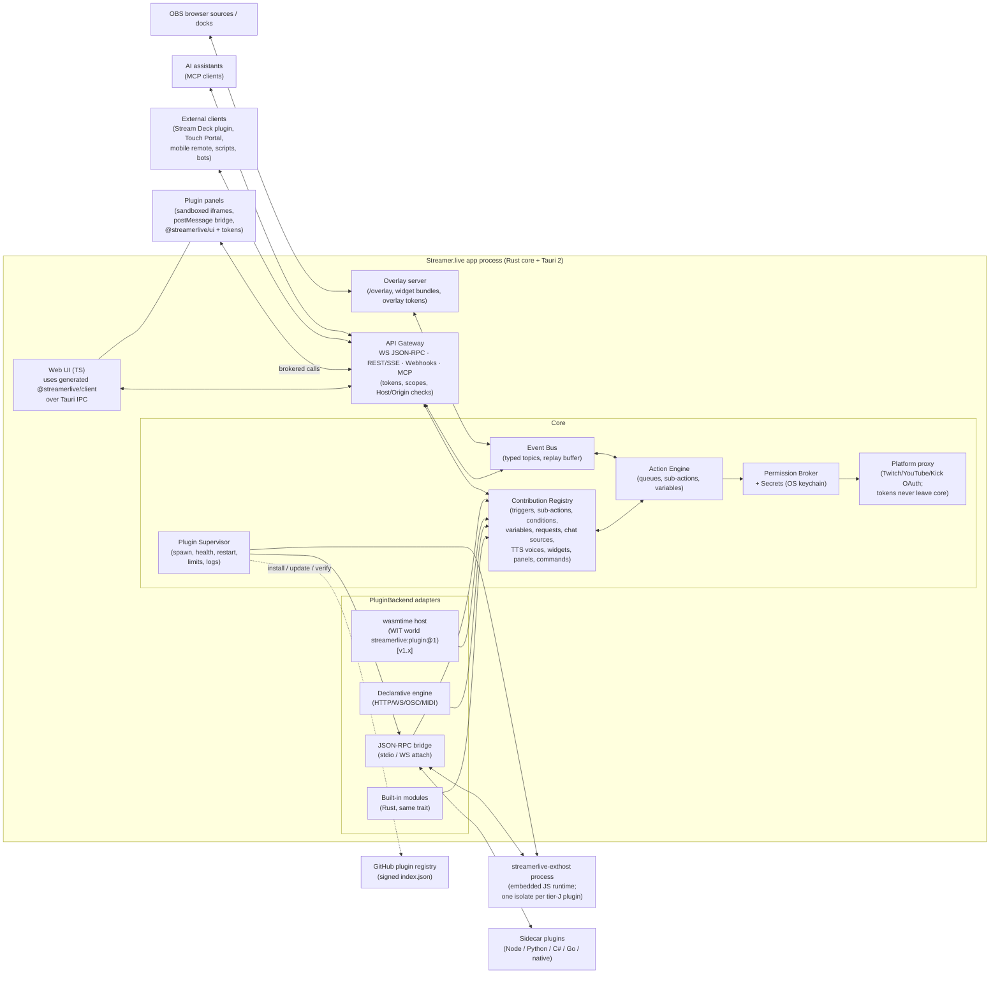

# Plugin SDK & Public API: Research and Recommended Design

> Project: Streamer.live, a cross-platform streaming automation hub (Streamer.bot + Speaker.bot + SAMMI parity).
> Assumed stack: Rust core (Tauri 2), TypeScript web UI, an embedded JS runtime and Python for user scripts.
> Research date: **2026-10-18**. Version numbers were checked against crates.io, npm and GitHub releases on that date.
> Status: recommendation draft for owner review.

---

## Contents

0. [TL;DR](#0-tldr)
1. [Part A: Prior art](#part-a--prior-art)
   - A1 Elgato Stream Deck SDK
   - A2 Touch Portal plugin API
   - A3 SAMMI extensions and local API
   - A4 Streamer.bot, Firebot, Lumia Stream, Mix It Up
   - A5 OBS Studio plugins and obs-websocket vendor requests
   - A6 VS Code extension model
   - A7 Home Assistant (integrations, config flows, HACS) and Node-RED
   - A8 Tauri plugins, Extism, the WASM Component Model / WASI 0.2–0.3, deno_core, JSON-RPC sidecars
   - A9 MCP (Model Context Protocol)
   - A10 Cross-cutting lessons
2. [Part B: Recommended design](#part-b--recommended-design)
   - B1 Plugin tiers (v1 vs later)
   - B2 Manifest schema (concrete example)
   - B3 Public API surface (WS, HTTP, auth, versioning, codegen and SDKs)
   - B4 "Feels native" checklist
   - B5 Security model
   - B6 GitHub-based community plugin registry
   - B7 Architecture diagrams
   - B8 Phasing
   - B9 Open questions for the owner
3. [Appendix: version snapshot (2026-10-18)](#appendix--version-snapshot-2026-10-18)

---

## 0. TL;DR

- **Model the platform on VS Code** (declarative contribution points, lazy activation, an out-of-process extension host, sandboxed webviews themed with CSS variables). For simple devices, also offer **no-code plugins** in the style of Touch Portal and Lumia (generated forms only). Expose plugin features over the public API the way **obs-websocket vendor requests** do: plugins register request handlers and events, and any API client can call or subscribe to them.
- **v1 plugin tiers:**
  - **(a) Declarative plugins**: a manifest that maps HTTP, WebSocket, OSC or MIDI calls. No code.
  - **(b) Sidecar plugins**: a separate process in any language, speaking JSON-RPC 2.0 over stdio. Official TypeScript and Python SDKs.
  - **(c) Embedded JS/TS plugins**: run in our own JS runtime inside a separate *extension-host* process, with permission-checked host APIs.
  - **WASM Component Model plugins** (wasmtime with WASI 0.3, which was ratified in June 2026) arrive in **v1.x as a preview**, then become the recommended tier for untrusted marketplace code.
- **Built-in integrations use the same contribution registry and Rust `Plugin` trait** that the external adapters map onto. At least two first-party integrations ship as real external plugins in v1, so those code paths stay honest.
- **Single source of truth:** Rust types with `serde` and `schemars`. They emit a JSON Schema 2020-12 catalog, `protocol.json`, which is the canonical artifact. From it we derive OpenAPI 3.1 (`utoipa` 6 or `aide`), AsyncAPI 3 docs for the WebSocket API, the UI's TS types and generated SDKs (TS, Python, C#, Rust). A CI drift check keeps them in sync. TypeSpec and protobuf were considered and rejected as the primary source (reasons in B3.6).
- **Public API:** WebSocket using JSON-RPC 2.0 envelopes with obs-websocket v5 semantics (Hello/Identify handshake, `rpcVersion` negotiation, opt-in high-volume events, batches). An HTTP REST mirror with SSE for events, an OpenAPI spec and inbound webhooks. Auth uses per-client scoped tokens issued through a **pairing flow**. Host and Origin are checked to block DNS rebinding and drive-by attacks from web pages.
- **MCP:** yes. Ship an **opt-in MCP server** (Rust `rmcp`, spec 2026-07-28, which is stateless). It exposes curated tools plus every sub-action's JSON Schema as a tool, and destructive tools require in-app confirmation.
- **Registry:** a GitHub "pointer" registry (Obsidian/HACS style). Authors open a PR that adds a small JSON entry. CI validates the manifest, release assets, hashes and permissions. A signed `index.json` is published. Any update that adds permissions is held for re-review.

---

# Part A: Prior art

## A1. Elgato Stream Deck SDK (current: SDK docs v3, `@elgato/streamdeck` 3.0.2, `@elgato/cli` 1.10.2)

| Aspect | Summary |
|---|---|
| **Extension model** | Each plugin is a separate process. Officially that is Node.js using the `@elgato/streamdeck` TS SDK; any executable worked historically. The app starts the plugin with connection arguments (port, plugin UUID, register event, info), and the plugin connects back to the app over a local WebSocket. Actions are classes such as `SingletonAction<Settings>` with handlers like `onKeyDown` and `onDidReceiveSettings`. Requires **Node.js 24+** and **Stream Deck 7.1+** for the current SDK ([getting started](https://docs.elgato.com/streamdeck/sdk/introduction/getting-started)). |
| **Manifest** | `manifest.json` with a published `$schema`. Fields include `UUID` (reverse-DNS, **immutable once on Marketplace**), `Version` (4-part), `SDKVersion` (2 or 3, 3 recommended), `Software.MinimumVersion`, `Nodejs.Version` (`"20"` or `"24"`), `Nodejs.Debug` (`enabled`/`break`/custom inspect args), `OS[]`, `CodePath` with per-OS overrides, `PropertyInspectorPath`, `Actions[]` (each with `UUID` prefixed by the plugin UUID, `States[]`, `Controllers` of `Keypad`/`Encoder`/`Neo`, encoder layouts), `Profiles`, and `ApplicationsToMonitor` ([manifest reference](https://docs.elgato.com/streamdeck/sdk/references/manifest)). Node plugins always run with `--enable-source-maps --no-global-search-paths`. |
| **UI contribution** | The **Property Inspector** is an HTML page per action (or plugin-wide) in `ui/`. **sdpi-components** web components (`<sdpi-textfield setting="name">` and others) **bind directly to action settings** and handle messaging, which gives a native look with almost no code. Debugging uses Chrome remote devtools on `localhost:23654` ([UI guide](https://docs.elgato.com/streamdeck/sdk/guides/ui)). Elgato now says to bundle `sdpi-components.js` locally; the CDN is for prototyping only. |
| **Packaging** | A `*.sdPlugin` folder (`bin/`, `imgs/`, `ui/`, `logs/`, `manifest.json`) is packed into a `.streamDeckPlugin` file by `streamdeck pack`, which also runs `validate` ([packaging](https://docs.elgato.com/sdk/plugins/packaging)). The CLI has `create`, `dev`, `link`/`unlink`, `restart`, `stop`, `validate` and `pack` ([elgatosf/cli](https://github.com/elgatosf/cli)). `npm run watch` rebuilds and restarts the plugin on change. |
| **Isolation** | Process isolation only. Plugins have full user-level OS access. |
| **Versioning/compat** | `SDKVersion` plus `Software.MinimumVersion` gate features (for example, `SupportedInKeyLogicActions` needs 7.0+, `Neo` needs 7.6+). |
| **Discovery** | **Elgato Marketplace** with submissions through **Maker Console**. Review takes about 4–10 business days. Since **19 Jan 2026** new plugins must be **DRM-compatible, require Stream Deck 6.9+ and use `SDKVersion` 3**. Updates have the same requirement since 19 Feb 2026 ([Maker Console](https://maker.elgato.com/), [distribution](https://docs.elgato.com/sdk/plugins/distribution)). |
| **Lessons** | **Good:** settings-bound UI components (sdpi) give a native feel cheaply. The CLI covers scaffold, link, watch/restart, validate and pack. Debug flags live in the manifest. Each action has typed settings. **Bad:** the Property Inspector is a separate HTML page per action, so styling drifts between plugins. Elgato's own docs say the PI docs are "still in development". There is no permission model. Requiring Node 24 forces runtime churn on authors. DRM and closed review make open-source distribution awkward. |

## A2. Touch Portal plugin API (API v13)

| Aspect | Summary |
|---|---|
| **Extension model** | A plugin is any process that opens a **TCP socket to `127.0.0.1:12136`** and exchanges **newline-terminated UTF-8 JSON**. It sends `{"type":"pair","id":...}` and receives `info` (sdkVersion, tpVersionString, saved settings, current page paths) ([setup connection](https://www.touch-portal.com/api/index.php?section=communication_setup_connection)). Messages are processed **asynchronously**, so ordering is not guaranteed. Incoming messages include `action`, `down`/`up` (hold), `connectorChange`, `listChange`, `settings`, `closePlugin`, `broadcast` and `notificationOptionClicked`. Outgoing messages include `stateUpdate`, `createState`, `removeState`, `choiceUpdate` (dynamic dropdowns), `connectorUpdate`, `settingUpdate`, `triggerEvent` and `showNotification`. |
| **Manifest** | `entry.tp` (JSON) declares `api` (the old `sdk` field is deprecated), `version` (an integer), `id`, `name`, `configuration` (colors, `parentCategory`), `plugin_start_cmd` with `_windows`/`_mac`/`_linux` variants and the `%TP_PLUGIN_FOLDER%` placeholder, `categories[]`, `settings[]` and `settingsDescription`. The API→app version table runs from 1 (v2.1) to 12 (v4.5), and the live docs are on 13 ([structure](https://www.touch-portal.com/api/index.php?section=description_file_structure)). |
| **Contribution types** | **Actions** come in two kinds: `communicate` (sent to the plugin) and `execute` (runs a command line). `data[]` fields are typed `text`/`number`/`switch`/`choice`/`file`/`folder`/`color`, and **`lines`** templates use `{$id$}` placeholders with per-language variants and `onhold` lines ([actions](https://www.touch-portal.com/api/index.php?section=description_file_actions)). **States** are plugin-owned variables. **Events** are declarative conditions on states (`valueStateId` + `valueChoices`, plus `localstates` that act as payload variables) ([events](https://www.touch-portal.com/api/index.php?section=description_file_events)). **Connectors** are sliders with `lowerBound`/`upperBound`. There are also **sub-categories** and **settings**. |
| **Packaging** | A `.tpp` file is a zip (renamed) containing exactly one root folder without spaces, holding `entry.tp`, icons and binaries ([plugin file](https://www.touch-portal.com/api/index.php?section=intro_plugin_file)). |
| **Isolation/security** | None beyond pairing by `id`. There is no auth on the socket. Touch Portal's position is that "the end user is responsible for only using safe and reliable plugins" ([2.1 release notes](https://www.touch-portal.com/blog/post/2020-03-09/New_in_release_version_2_1.php)). |
| **Discovery** | No first-party store. Plugins are found through community sites, Discord and GitHub. |
| **Lessons** | **Good:** the protocol is tiny and language-agnostic, so it has SDKs in many languages. States, events driven by states and dynamic choice lists (`choiceUpdate`) are a pleasant model. Templated "sentence" action lines (`Set volume of {$device$} to {$level$}`) read naturally in the editor. Per-OS start commands. **Bad:** the socket is unauthenticated and any local process can pair. Asynchronous message processing causes ordering bugs. The version is an integer and there is no semver or compat range. Placeholder syntax and deprecated fields have accumulated over 13 API versions. There is no registry. |

## A3. SAMMI extensions and local API

| Aspect | Summary |
|---|---|
| **Extension model** | Extensions are **HTML/JS inserted into "Bridge"**, a `bridge.html` page usually docked in OBS as a Custom Browser Dock. Bridge connects to SAMMI Core over WebSocket (default `127.0.0.1:9425`, optional password). Only one Bridge may be open at a time ([Bridge docs](https://sammi.solutions/docs/bridge)). |
| **Manifest/package** | A **`.sef`** text file with sections: `[extension_name]`, `[extension_info]`, `[extension_version]`, `[insert_external]` (HTML/CSS for the extension's Bridge tab), `[insert_command]` (declares Extension Commands via `SAMMI.extCommand(name, color, height, {param: [label, boxType, default]})`), `[insert_hook]` (legacy), `[insert_script]` (JS) and `[insert_over]` (a deck JSON plus `sammi_version`, `obswebsocket`, `required_extension` and `extension_triggers`) ([build guide](https://sammi.solutions/extensions/build)). Commands are handled with `sammiclient.on('<command>', payload => ...)`, and `SAMMI.setVariable/getVariable/alert` call back into Core. |
| **UI** | Each extension gets a free-form HTML tab in Bridge. Command parameters render as SAMMI "boxes" chosen by numeric type codes. |
| **Local API** | HTTP at `localhost:9450/api` (SAMMI 2022.5.0+). Requests are GET with `?request=getVariable&...` or POST with JSON `{request: ...}`, plus an optional `Authorization: <password>` header. Requests: `getVariable`, `setVariable`, `deleteVariable`, `insertArray`, `deleteArray`, `getDeckStatus`, `changeDeckStatus`, `triggerButton`, `releaseButton`, `modifyButton`, `popupMessage`, `alertMessage`, `notificationMessage`, plus webhook triggers ([overview](https://sammi.solutions/docs/api/overview), [reference](https://sammi.solutions/docs/api/reference)). |
| **Isolation** | Extensions run in a browser page (CEF or browser), so they get browser-level sandboxing. However, they share one page, so any extension can read any other's data and Core's variables. |
| **Distribution** | An extensions directory on sammi.solutions, Discord `#extension-releases`, and a PR to [SAMMI-Bridge `extensions/`](https://github.com/SAMMISolutions/SAMMI-Bridge) adding a JSON file for update checks. |
| **Lessons** | **Good:** a browser context is a natural sandbox for web developers. Commands are declared with typed parameter boxes. `[insert_over]` ships ready-made decks/buttons with the extension, which works as onboarding content. A GitHub-PR-based update index. **Bad:** a single-page "Bridge" must be open, usually inside OBS, so it is fragile. Large payloads over WebSocket get dropped and authors must chunk them manually. Magic numeric box types. All extensions share one global page. The section-delimited text format is hard to validate or tool. |

## A4. Streamer.bot, Firebot, Lumia Stream, Mix It Up

### Streamer.bot (v1.0.x stable; v1.1.0 alpha)
- **WebSocket server:** default `127.0.0.1:8080`, endpoint `/`, auth off by default ([configuration](https://docs.streamer.bot/api/websocket/guide/configuration)). Requests are JSON `{request, id}` and responses are `{status:"ok"|"error", id}`. Requests include `Subscribe`/`UnSubscribe`, `GetEvents`, `GetActions`, `DoAction`, `GetBroadcaster`, `GetInfo`, `GetActiveViewers`, `GetCodeTriggers`, `ExecuteCodeTrigger`, `GetCommands`, `GetGlobals`/`GetGlobal`, `TwitchGetUserGlobals`, `SendMessage`, `GetUserPronouns` and others ([requests](https://docs.streamer.bot/api/websocket/requests)). Auth is an obs-websocket-style **salt/challenge SHA-256** in `Hello`, followed by an `Authenticate` request. **There are no per-client scopes** ([authentication](https://docs.streamer.bot/api/websocket/guide/authentication)). The official JS client is `@streamerbot/client` ([client](https://docs.streamer.bot/api/websocket/guide/client)).
- **C# code:** the "Execute C# Code" sub-action compiles a `CPHInline` class in-process with `Execute()`, `Init()` (on first compile or startup) and `Dispose()` ([lifecycle](https://docs.streamer.bot/api/csharp/guide/lifecycle-methods)), plus custom DLL references. **Custom triggers** are registered from C# with `RegisterCustomTrigger` (category arrays for nesting); the docs advise registering in `Init()` with "Precompile on application start" ([triggers](https://docs.streamer.bot/guide/triggers)). There is no sandbox: code has full .NET and OS access.
- **"Extensions":** community **`.sb` import strings** (exported actions, triggers and commands) shared on [extensions.streamer.bot](https://extensions.streamer.bot/) (Discourse). Imported commands are disabled by default. Old exports can fail with "import is too old", which requires a round-trip through v0.2.3 ([FAQ](https://docs.streamer.bot/faq/old-import)).
- **Lessons:** the power-user favorite works because **anything is possible in C#**. The costs: no isolation (one bad script hangs the app), no packaging or versioning (import strings are opaque, version-locked blobs), and extensions with **no settings UI**, configured by editing globals or arguments. v1.1.0 restructured event payloads "to support auto-generated documentation" ([changelog](https://docs.streamer.bot/changelogs/v1.1.0)), which confirms the value of schema-first payloads from the start.

### Firebot (v5.6x)
- **Custom scripts** are Node modules exporting `run(runRequest)`, optional `getScriptManifest()` (name, version, author, `startupOnly`, `firebotVersion`) and `getDefaultParameters()`. Parameter types (string, password, number, boolean, enum, filepath, effectlist) generate the UI automatically ([scripts](https://docs.firebot.app/v5/dev/scripts)).
- **Startup scripts are the de facto plugins.** They receive a large `ScriptModules` object: `effectManager`, `eventManager`, `replaceVariableManager`, `integrationManager`, `httpServer`, `webhookManager`, `overlayWidgetsManager`, `uiExtensionManager` (5.64+), `twitchApi`, `frontendCommunicator`, `fs`, `childProcess` and more ([types](https://github.com/crowbartools/firebot-custom-scripts-types)). UI extensions register **AngularJS pages, components and directives** into the host UI. Overlay widget types declare a `settingsSchema`, `initialState`, `supportsLivePreview` and UI actions. Plugins are installed by copying a `.js` file and adding it under "Manage Startup Scripts" (for example, [firebot-plugin-kofi](https://github.com/zunderscore/firebot-plugin-kofi) requires Firebot 5.65+).
- **Lessons:** **Good:** startup scripts can add effects, events, variables, webhooks and overlay widgets, all of which appear in the native pickers. **Bad:** plugins run **in-process with the full internal module graph**, so internal refactors break plugins and authors must annotate deprecations such as "`fs` will be removed in 5.66". UI extensions are **coupled to AngularJS**, an EOL framework. There is no sandbox, packaging or registry.

### Lumia Stream (Plugin SDK, `lumiaVersion` ^9)
- Plugins are JS classes (`@lumiastream/plugin`) that run in an **isolated Node.js process** with no DOM ([overview](https://dev.lumiastream.com/docs/plugin-sdk/overview)). The manifest has `id`, `version` (semver), `lumiaVersion` (a semver range) and `category`. `config.settings` field types include text, password, number with validation, toggle, select, file, `roi`, `named_map` and `json`. `config.actions` field types add `visibleIf`. `config.variables` and `config.alerts` support `variationConditions` and `acceptedVariables`. `translations` are inline or a file. The flags **`hasAI`** (the plugin becomes an AI provider via `aiPrompt`/`aiModels`) and **`hasChatbot`** route chatbot traffic to the plugin. `isolation: "shared" | "process"` is set at runtime ([manifest guide](https://dev.lumiastream.com/docs/plugin-sdk/manifest-guide)).
- Tooling: `npx lumia-plugin create | validate | build` produces **`.lumiaplugin`** archives. The `skills` command installs AI-assistant guidance for Codex, Claude, Copilot, Gemini CLI and Cursor. Custom HTML is allowed only for an auth/setup modal (`custom_auth_display`), and the docs recommend using Lumia's palette.
- **Lessons:** this is the closest prior art to our goals. It has "provider" contribution types (AI, chatbot) that match our chat-source and TTS-provider needs, schema-generated forms, compat ranges, and a CLI with AI-agent skills. It still has **no permission model**.

### Mix It Up
- The **Developer API** is REST at `http://localhost:8911/api/v2`, enabled on the Services page. It covers status, users, currency/inventory, counters, chat and commands (run/enable/disable/toggle) ([developer API](https://mixitup.bot/docs/reference/developer-api), [reference](https://mixitup.bot/desktopapidocs/)). The docs describe no auth. There is no plugin SDK; extensibility comes from script actions, overlay widgets, webhooks and external program actions.
- **Lesson:** an API-only story with no auth is easy to adopt but cannot add new triggers or sub-actions. The UI cannot be extended.

## A5. OBS Studio plugins and obs-websocket vendor requests

- **OBS plugins** are native C/C++ modules (`obs_module_load`) loaded **in-process**. They are ABI-coupled to OBS major versions, have no sandbox, and are installed per platform. OBS **32.0 introduced an initial Plugin Manager** for enabling and disabling plugins (not a store). 32.1 rewrote the audio mixer and broke some plugins, which shows the cost of in-process native ABIs ([OBS 32.1.1 notes, third-party summary](https://obs-versions.com/blog/obs-studio-32-1-1-release-notes)).
- **obs-websocket v5 protocol** ([protocol.md](https://github.com/obsproject/obs-websocket/blob/master/docs/generated/protocol.md)), the model we should copy:
  - Envelope `{op, d}` with OpCodes `Hello(0)`, `Identify(1)`, `Identified(2)`, `Reidentify(3)`, `Event(5)`, `Request(6)`, `RequestResponse(7)`, `RequestBatch(8)` and `RequestBatchResponse(9)`.
  - Subprotocols `obswebsocket.json` and `obswebsocket.msgpack`.
  - **`rpcVersion` increments only on breaking changes.** Client and server negotiate it, and `obsWebSocketVersion` serves as a soft feature-level hint.
  - `eventSubscriptions` is a bitmask. **High-volume events are opt-in.** `Reidentify` changes subscriptions mid-session.
  - Batches have execution types `SerialRealtime`, `SerialFrame` and `Parallel`, with `Sleep` for timing.
  - Status codes are numeric with optional comments. Field names are consistent (`sceneName`, `inputName`, ...).
  - Docs are **generated from code comments** into `protocol.json`, then `protocol.md`.
- **Vendor requests:** a third-party OBS plugin or script registers a **vendor name** through the `obs-websocket-api.h` helper API (`obs_websocket_register_vendor`, `obs_websocket_vendor_register_request`, `obs_websocket_vendor_emit_event`) ([header](https://github.com/obsproject/obs-websocket/blob/master/lib/obs-websocket-api.h)). Clients call `CallVendorRequest {vendorName, requestType, requestData}` and receive `VendorEvent {vendorName, eventType, eventData}` behind the `Vendors` subscription bit. Plugins can also call obs-websocket requests in-process (`obs_websocket_call_request`).
- **Lesson:** this pattern lets **any plugin extend the public API without the API owner shipping new code**, and every existing client library supports it immediately. We adopt it as `plugins.call` and plugin events namespaced under the plugin id. The weakness is that vendor payloads are untyped (documentation is "expected to be provided" by the vendor). We fix that by requiring JSON Schemas in the manifest, so vendor requests appear in generated docs and SDKs.

## A6. VS Code extension model (the gold standard for "feels native")

- **Manifest = `package.json`** with `engines.vscode` (a semver range), `contributes.*` (**contribution points**: commands, menus, keybindings, configuration (a JSON Schema that generates the Settings UI), views and viewsContainers, languages, themes, walkthroughs, and more) ([contribution points](https://code.visualstudio.com/api/references/contribution-points)). Contributions are **declarative and visible before activation**, so commands appear in the palette and settings in the Settings UI without running extension code.
- **Activation events:** `onCommand`, `onView`, `onLanguage`, `onUri`, `onStartupFinished` and more. Since 1.74, contributed commands, views and other contributions **imply** their activation events. `*` is discouraged ([activation events](https://code.visualstudio.com/api/references/activation-events)).
- **Extension host:** extensions run in a **separate process** (Node locally or remotely, or a Web Worker for web) and **cannot touch the UI DOM**. VS Code says the host prevents extensions from "impacting startup performance, slowing down UI operations, modifying the UI" ([extension host](https://code.visualstudio.com/api/advanced-topics/extension-host)). `extensionKind` chooses UI-side or workspace-side placement.
- **Webviews:** "think of a webview as an `iframe`". Scripts are disabled by default. A strict **CSP** is recommended. `localResourceRoots` limits file access. Messaging uses `acquireVsCodeApi().postMessage` and `onDidReceiveMessage`, and `getState`/`setState` provide persistence. **Theme integration** comes from body classes (`vscode-light`, `vscode-dark`, `vscode-high-contrast`) and **CSS variables** (`--vscode-editor-foreground` and others) ([webview guide](https://code.visualstudio.com/api/extension-guides/webview)).
- **Security reality:** "The extension host has the same permissions as VS Code itself". There is no capability sandbox. Mitigations are **publisher trust prompts (1.97+)**, verified publishers, **Marketplace signing of every extension with client-side signature verification**, malicious-extension takedown and Workspace Trust ([runtime security](https://code.visualstudio.com/docs/configure/extensions/extension-runtime-security)).
- **Lessons:** **Good:** declarative contributions, lazy activation, a process boundary, themed webviews and generated settings UIs. **Bad/cautionary:** the official **webview-ui-toolkit was archived**, so a separately maintained plugin UI kit drifts and dies ([repo, archived](https://github.com/microsoft/vscode-webview-ui-toolkit)). Our plugin UI kit should be *the same component library the app uses*, not a parallel one. Without a capability sandbox, the real-world malware incidents in the Marketplace led to trust prompts as an after-the-fact fix. We should design permissions in from day one.

## A7. Home Assistant and Node-RED

### Home Assistant integrations and HACS
- **`manifest.json`** fields: `domain`, `name`, `version` (**required for custom integrations**; any AwesomeVersion SemVer or CalVer), `integration_type`, `documentation`, `issue_tracker`, `dependencies`/`after_dependencies`, `codeowners`, `config_flow`, `requirements` (pip), `loggers`, **discovery matchers** (`zeroconf`, `ssdp`, `dhcp`, `usb`, `bluetooth`, `homekit`, `mqtt`), `quality_scale` and **`iot_class`** (`local_push`, `local_polling`, `cloud_push`, `cloud_polling`, `assumed_state`, `calculated`) ([manifest docs](https://developers.home-assistant.io/docs/creating_integration_manifest)).
- **Config flows:** a step-based wizard (`async_step_user`, discovery steps, `reauth`, **options flow**). Each step returns a form from a schema, so the frontend renders native forms, and `strings.json` supplies localized labels. Config entries persist the result ([config flow](https://developers.home-assistant.io/docs/config_entries_config_flow_handler)). The **entity model** (typed platforms such as `sensor` and `switch`, with device classes and units) gives every integration a uniform UI. The **Integration Quality Scale** (Bronze to Platinum) signals maturity.
- **HACS:** custom repos plus a curated **default list in [hacs/default](https://github.com/hacs/default)** (3,536 integrations as of today). Inclusion is by **PR from the repo owner or a major contributor**. The repo must pass the **HACS Action** (checks for description, topics, license, `hacs.json`, brand images, issues enabled, not archived) and **hassfest**, and must have a full GitHub release. Entries go in alphabetical order. PRs are drafted for minor issues and closed for major ones ([include](https://hacs.xyz/docs/publish/include), [action](https://hacs.xyz/docs/publish/action)).
- **Lessons:** discovery matchers declared in the manifest give zero-config device onboarding, which would suit VTube Studio, Voicemeeter, smart lights, VoiceMod and similar. Config, options and reauth flows give a consistent connection UX. A quality scale is a cheap trust signal. HACS shows that a **GitHub-PR pointer registry with an automated validation Action** scales to thousands of entries with a small team.

### Node-RED (5.0.8 / 4.1.16 current)
- A node is a **runtime `.js`** (registers a type and handles messages) plus an **editor `.html`** with `<script type="text/html" data-template-name>` for the edit form, `data-help-name` for help, and `RED.nodes.registerType(type, {category, defaults, credentials, inputs, outputs, icon, oneditprepare, ...})` ([node HTML](https://nodered.org/docs/creating-nodes/node-html)). `credentials` are stored separately from the flow, which is a good model for plugin secrets.
- **Packaging:** npm with a `node-red` section in `package.json` (`nodes`, `version: ">=x"` compat), the `node-red` keyword, **scoped names** for new packages (since 2022), and `examples/`, `icons/` and `locales/` folders. The **Flow Library** stopped auto-indexing npm in 2020 and **requires submission**. It shows a **scorecard** ([packaging](https://nodered.org/docs/creating-nodes/packaging)).
- **Lessons:** editor and runtime are split cleanly. Bundled example flows are excellent onboarding. Credentials are separated from config. Auto-indexing npm by keyword failed (spam and quality problems), so curated submission won.

## A8. Embedding technologies

### Tauri 2 plugins (tauri 2.12.4 stable; 3.0.0-alpha.5 in development)
- Tauri plugins are **Rust crates compiled into the app**, plus optional JS bindings and mobile code. They **cannot be loaded at runtime by third parties**. Their value to us is the **permission/capability system**: plugins ship named permissions (`commands.allow/deny` plus **scopes** such as glob paths or URL patterns, where *deny supersedes allow*). App capabilities grant permissions to specific **windows, webviews or remote URLs**, and multiple capabilities on one window merge ([capabilities](https://v2.tauri.app/security/capabilities/), [permissions](https://v2.tauri.app/security/permissions/), [scope](https://v2.tauri.app/security/scope/)).
- **Use:** structure our *internal* modules as Tauri plugins where they expose IPC to the UI. Copy the **permission-identifier vocabulary and allow/deny scope semantics** for our plugin permission model. Give plugin panel webviews a capability that **allows no Tauri IPC**, so they only reach the host through our brokered `postMessage` bridge. Watch Tauri 3: alpha now, so plan the migration later.

### Extism (1.41.0)
- A cross-runtime WASM plugin framework ("execute arbitrary, untrusted code from your users... safe and practical") ([repo](https://github.com/extism/extism)). Built on wasmtime using **core modules, not the Component Model**. The manifest supports `wasm[]` with **hash pinning**, `memory.max_pages`, `max_http_response_bytes`, `max_var_bytes`, **`allowed_hosts`**, **`allowed_paths`**, `config` and **`timeout_ms`** (from the [manifest source](https://github.com/extism/extism/blob/main/manifest/src/lib.rs)). Provides host-controlled HTTP without WASI, persistent plugin variables, simple host-function linking, and PDKs for Rust, JS (QuickJS-based), Go, Python, C#, Zig, AssemblyScript, C and Haskell.
- **Pros:** fastest path to sandboxed multi-language plugins today, with a permission model that maps directly to our needs. **Cons:** a byte-in/byte-out ABI (we would define JSON payloads and schemas ourselves). Not standards-track like the Component Model. Native async is weaker than WASI 0.3. A second runtime abstraction over wasmtime.

### WebAssembly Component Model / WASI 0.2 → 0.3 (wasmtime 49.0.3; 50.0.0-rc.1)
- **WASI 0.3.0 was released and ratified on 11 June 2026**. It moves `wasi:io` streams and futures into the Component Model's **native async** canonical ABI, so bindings generators produce idiomatic async code ([BA announcement](https://bytecodealliance.org/articles/WASI-0.3), [wasi.dev P3](https://wasi.dev/releases/wasi-p3)). Wasmtime turned P3 and component-model-async on by default in its mid-2026 releases. Toolchain: `wit-bindgen` 0.63, `jco` 1.39 (JS host/transpile and componentize), `componentize-py`. The migration guide lists wit-bindgen 0.46+ and wkg 0.15+ ([P2→P3 migration](https://component-model.bytecodealliance.org/design/migrating-to-p3.html)). Guest-language P3 support for **JS, Python and Go is still maturing**.
- **Pros:** **typed WIT interfaces** with codegen for host (Rust) and guest. A capability-based sandbox (nothing is reachable unless linked). Fuel and epoch interruption for CPU limits, memory limits, and near-native speed. Standards-track. Multi-language. Tiny artifacts for Rust and Go guests.
- **Cons:** guest tooling churns (all 0.x). JS and Python guests embed whole interpreters (multi-MB components, slower cold start). Debugging is harder than a sidecar. Plugins needing OS facilities such as raw sockets, MIDI, HID or native SDKs (Elgato, Voicemeeter DLLs) cannot run as WASM.
- **Fit:** the **long-term default for marketplace code** (sandboxed by construction). Ship as preview after the sidecar tier, and **design the host API as WIT from day one** so JSON-RPC and WIT are two bindings of one interface.

### `deno_core` (0.412.0) and alternatives
- `deno_core` embeds V8 with **ops** (`#[op2]` Rust functions exposed to JS) grouped into `extension!` bundles. It has **no ambient I/O**: a bare isolate can do nothing unless you register ops, which gives a natural capability model where every op checks plugin permissions. Deno's `--allow-*` permission system lives in the higher `deno_runtime` layer, not in `deno_core`, so we implement our own checks ([crate](https://crates.io/crates/deno_core); background: [embedding notes](https://deno.land/x/manual@v1.21.3/embedding_deno.md)). Alternatives: **rquickjs 0.14** (QuickJS: small, fast startup, slower JIT-less execution) and **Boa 0.22** (pure Rust, slower).
- **Caveat:** there is **no Node API compatibility** without `deno_runtime` and the node-compat layer, which are heavy. Many npm device SDKs (`node:net`, native addons) will not run. This is why embedded-JS plugins are a *lightweight* tier, and full-Node plugins are sidecars.
- V8 isolates give memory isolation and heap limits, but V8 OOM or crashes take down the hosting process. Run plugin isolates in a **separate extension-host process**, not the core.

### JSON-RPC sidecar processes (LSP and MCP style)
- LSP proves the model: an editor and a language server in *any* language communicating over **JSON-RPC 2.0 on stdio**, with a capabilities handshake (`initialize`/`initialized`), lifecycle (`shutdown`/`exit`), `$/progress` and `$/cancelRequest`. MCP adopted the same pattern with newline-delimited JSON on stdio. Rust has mature crates (`jsonrpsee` 0.26.1).
- **Pros:** any language, full OS capability, crash isolation, debuggable with normal tools, trivial "attach to a running dev process" over WebSocket. **Cons:** **no sandbox** (only OS-user privileges), per-plugin runtime packaging (Node, Python, .NET), and process overhead.

## A9. MCP (Model Context Protocol): should Streamer.live expose an MCP server?

- **Spec status:** the current revision is **2026-07-28**, which is **stateless**. It removes the `initialize` handshake and `Mcp-Session-Id`. Every request carries protocol version and capabilities in `_meta`, and `server/discover` is mandatory. `subscriptions/listen` replaces the GET/SSE stream. A **Multi Round-Trip Request** pattern (`input_required` results) replaces server-initiated elicitation and sampling. Tool `inputSchema`/`outputSchema` accept full **JSON Schema 2020-12**. Roots, Sampling and Logging are deprecated ([changelog](https://github.com/modelcontextprotocol/modelcontextprotocol/blob/main/docs/specification/2026-07-28/changelog.mdx)). Official extensions include **MCP Apps** (UI resources rendered in AI clients) ([ext-apps](https://github.com/modelcontextprotocol/ext-apps)), Tasks and Auth. SDKs: Rust **`rmcp` 3.5.1** ([rust-sdk](https://github.com/modelcontextprotocol/rust-sdk)) and TS `@modelcontextprotocol/sdk` 1.32.1.
- **Evaluation: yes, opt-in, v1.x.** The cost is low because our sub-actions and API requests already carry JSON Schema 2020-12 parameter schemas, which map 1:1 to MCP tools.
  - **Tools:** a curated core set (`run_action`, `list_actions`, `get/set_variable`, `send_chat`, `obs_switch_scene`, `create_clip`, ...) plus **auto-exposed plugin sub-actions** (opt-in per plugin and per action).
  - **Resources:** action catalog, variables, recent events, logs.
  - **Transports:** Streamable HTTP on localhost (requires a scoped token), plus a tiny `streamerlive-mcp` stdio shim for desktop AI clients.
  - **Safety:** every MCP client is just an API client with **scopes**. Tools tagged `destructive` (ban user, end stream, spend points, run arbitrary code) return `input_required` and trigger an **in-app approval toast**. Rate limits apply per client.
  - **Later:** act as an **MCP client** too. A generic "Call MCP tool" sub-action effectively turns any MCP server into a plugin with zero SDK work.

## A10. Cross-cutting lessons

1. **Declarative before imperative.** Contributions declared in a manifest (VS Code, Touch Portal, Lumia, HA) appear in pickers and search, are documented automatically and work before code runs. Registration only at runtime, as in Firebot startup scripts and Streamer.bot `RegisterCustomTrigger`, hides features until load and makes validation impossible.
2. **Schema-generated forms are the biggest "native feel" lever.** sdpi-components, Firebot parameters, Lumia field types and HA config flows all use them. Custom HTML should be the exception (VS Code: use webviews sparingly).
3. **Never expose internals as the plugin API.** Firebot's module graph and OBS's C ABI show the breakage. Expose a versioned, narrow facade.
4. **Process or sandbox boundaries pay off.** Stream Deck, Lumia and the VS Code extension host survive plugin crashes. In-process C# and Node (Streamer.bot, Firebot) do not.
5. **Local servers need real auth.** Touch Portal's open socket, Mix It Up's REST API without auth and Streamer.bot's auth-off-by-default WebSocket are exploitable by any local process, and by **web pages via DNS rebinding or cross-origin WebSocket** if Origin is not checked.
6. **Version with integers for breaking changes and ranges for compatibility.** obs-websocket's `rpcVersion` combined with VS Code/Lumia `engines` semver ranges is the best mix.
7. **Curated, validated submission beats auto-indexing.** Node-RED moved away from npm auto-indexing. HACS, Obsidian and Raycast use PR-based registries.
8. **The plugin UI kit must be the app's own UI kit.** The VS Code webview toolkit was archived.

---

# Part B: Recommended design

## B1. Plugin tiers

All tiers feed **one in-core Contribution Registry** through **one Rust trait** (`trait PluginBackend`): `invoke_action`, `on_settings_changed`, `connect`/`disconnect`, `handle_request`, `provide_options`, `tts_synthesize`, `chat_send`, and so on. Built-ins implement the trait natively. Each external tier is an adapter that implements it.

| Tier | What it is | Safety | Performance | Packaging | Dev ergonomics | Recommendation |
|---|---|---|---|---|---|---|
| **D: Declarative** | Manifest only: sub-actions map to HTTP, WebSocket, OSC, MIDI or UDP calls with templated bodies. Triggers come from webhooks, WS messages or polling with JSONPath/JMESPath extraction into typed payloads. Connections come from config fields. | **Highest.** No code runs, and the host enforces the network allowlist. | Host-native | Single small folder or zip | Trivial. A "plugin from a curl command" wizard is possible. | **v1.** Covers smart lights (WLED, Hue, Govee LAN), simple REST and WS devices, and webhook services (Ko-fi-style). Very easy registry review. |
| **S: Sidecar (JSON-RPC 2.0)** | A separate process over stdio (newline-delimited JSON, MCP-style), plus **WS attach mode** for dev and debugging. Any language. Official SDKs: **TypeScript (Node/Bun/Deno)** and **Python** in v1; **C#** and **Go** later. | **Lowest.** OS-user privileges. Permissions are enforced only on host APIs, and the plugin is labelled "Full system access". | Good, with IPC overhead around 0.1 ms. | Per-platform binaries, or a script plus a declared runtime (`node`, `python`) that the host provisions. | Best. Use any library, native SDKs, normal debuggers. | **v1.** Required for device SDKs (Elgato, Voicemeeter, MIDI/HID, VTube Studio clients) and heavy integrations. Built-in "power" integrations should dogfood this tier. |
| **J: Embedded JS/TS** | TS/JS run in **our** JS runtime (the same engine as user scripts), one isolate per plugin, inside a **separate `streamerlive-exthost` process**. Host APIs are permission-checked ops: `fetch` filtered by host allowlist, WebSocket, timers, KV, events and variables. TS is transpiled with swc at load. | **Medium-high.** No ambient I/O and only brokered capabilities. A V8 escape is the residual risk. | Very good, with fast hot reload. | Tiny: `plugin.json` plus `main.js`. | Very good for web developers, but **no Node built-ins or npm native modules**. | **v1.** The default tier for typical integrations (REST/WS services, chat sources, overlay data). Reuses the runtime we already embed. |
| **W: WASM Component** | A wasmtime-hosted component implementing the `streamerlive:plugin@1` WIT world (WASI 0.3 async). Any language (Rust and Go first-class; JS and Python via componentize). | **Highest for code.** Capability-based, with fuel/epoch CPU limits and memory caps. | Near-native (Rust/Go); slower cold start for JS/Python. | Single `.wasm` per plugin, cross-platform. | Medium: WIT and toolchain churn, harder debugging. | **v1.x preview, v2 recommended for marketplace.** Design the WIT now so it mirrors the JSON-RPC methods 1:1. |
| *(Compat)* | Adapters that run **Touch Portal `.tpp`** plugins (TCP JSON, `entry.tp` mapped to our manifest). Possibly SAMMI `.sef` command subsets. | Same as Sidecar | n/a | n/a | n/a | **Optional, later.** Bootstraps the ecosystem. The owner should decide. |

**Why this split for v1:**
- *Safety:* tiers D and J cover most community plugins with real sandboxing. Tier S is honest "full trust", with clear labelling and a stricter registry tier.
- *Performance:* triggers are event-rate workloads (tens per second), well within the budget for JSON-RPC and isolates.
- *Packaging:* D and J are cross-platform single archives. S needs per-OS binaries or a host-provisioned runtime (Node or Python via `uv`), which is acceptable for power plugins.
- *Ergonomics:* developers can start in J or D and move to S only when they need native access. W waits until the WASI 0.3 guest story stabilises, since guest support for JS, Python and Go is still in progress as of mid-2026.

**Dogfooding rule:** core-critical integrations (Twitch, YouTube, Kick, OBS) stay compiled-in Rust modules against the same `PluginBackend` trait and the same manifest/contribution format (embedded as `builtin:` manifests). **At least two first-party integrations ship as external plugins in v1**, for example VTube Studio as tier J and Voicemeeter or MIDI as tier S. The **UI itself is an API client** using the generated TS SDK over Tauri IPC, so no UI-only private endpoints can exist.

### Plugin ↔ host protocol (Sidecar tier; the same method set is used as WIT functions)
JSON-RPC 2.0, LSP/MCP style:

| Direction | Method | Purpose |
|---|---|---|
| host→plugin | `initialize` → result `{capabilities}` | Hands over host version, `pluginApi` version, granted permissions, settings and locale. The plugin replies with its dynamic capabilities. |
| host→plugin | `connection/connect`, `connection/disconnect`, `connection/test` | Connection lifecycle (see B2). |
| host→plugin | `action/invoke {actionId, params, context}` | Runs a sub-action. Params are already schema-validated. Returns `{outputs}`, which become variables. Supports `$/cancelRequest` and `timeoutMs`. |
| host→plugin | `options/provide {field, params}` | Dynamic dropdowns (Touch Portal `choiceUpdate` / Stream Deck datasource equivalent). |
| host→plugin | `request/handle {method, params}` | Plugin-defined public API requests (the vendor-request equivalent). |
| host→plugin | `settings/didChange`, `shutdown` | Settings and lifecycle. |
| host→plugin | `tts/synthesize`, `tts/listVoices`, `chat/send` | Provider contributions. |
| plugin→host | `trigger/emit {triggerId, payload}` | Payload is validated against the manifest schema, then mapped to variables. |
| plugin→host | `connection/status`, `variables/set`, `chat/message`, `$/log`, `$/progress` | State, chat ingestion, logging. |
| plugin→host | `host/http`, `host/platform.call`, `host/kv.*`, `host/secrets.get`, `host/actions.run`, `host/obs.call` | **Brokered capabilities** (permission-checked). Platform API calls are proxied so **plugins never see the user's OAuth tokens**. |

Binary data such as TTS audio uses a side channel (a local named pipe or temp file handle, or binary WS frames in attach mode), not base64 in JSON.

## B2. Manifest schema

**Format:** `plugin.json` (JSON with `$schema`). JSON gives editor IntelliSense and validation, matching Stream Deck, VS Code and Lumia. The schema itself is generated from Rust types (B3.6). User-facing strings may use `%key%` placeholders resolved from `l10n/<locale>.json` (the VS Code `package.nls.json` pattern). Contribution IDs are local and become globally `<pluginId>/<localId>`. Payload and parameter schemas are **JSON Schema 2020-12**, with UI hints in an `x-ui` keyword.

### B2.1 Full example: a third-party streaming-platform integration (tier J)

```jsonc
{
  "$schema": "https://schemas.streamer.live/plugin/v1.json",
  "manifestVersion": 1,
  "id": "io.github.alice.acmelive",            // reverse-DNS; io.github.<owner> namespace is verified against the repo owner
  "slug": "acme",                                // short prefix for variables/events: {acme.gift.amount}, event "acme.gift"
  "name": "%plugin.name%",
  "version": "1.4.2",                            // SemVer
  "description": "%plugin.description%",
  "author": { "name": "Alice", "url": "https://github.com/alice" },
  "license": "MIT",
  "repository": "https://github.com/alice/streamerlive-acmelive",
  "homepage": "https://alice.dev/acmelive",
  "icon": "assets/icon.svg",                     // monochrome SVG; tinted by theme
  "categories": ["platform", "chat", "alerts"],
  "keywords": ["acme", "gifts", "multichat"],

  "engines": {
    "streamerlive": ">=1.2.0 <2.0.0",            // app version range
    "pluginApi": "^1.3"                          // host protocol / WIT world version
  },

  "runtime": {
    "kind": "js",                                // "declarative" | "js" | "sidecar" | "wasm"
    "entry": "dist/main.js",
    "isolation": "process"                       // exthost process (default); "dedicated" = own exthost process
    // sidecar example:
    // "kind": "sidecar", "command": { "windows": "bin/acme.exe", "macos": "bin/acme", "linux": "bin/acme" },
    // or "kind": "sidecar", "interpreter": "python>=3.12", "entry": "src/main.py", "requirements": "requirements.lock"
    // wasm example: "kind": "wasm", "component": "plugin.wasm", "world": "streamerlive:plugin/integration@1.3.0"
  },

  "activation": ["onConnectionEnabled", "onAction", "onPanel:dashboard"],   // lazy; contributions imply activation (VS Code ≥1.74 style)

  "permissions": {
    "network": {
      "http":  ["https://api.acme.live/*", "https://cdn.acme.live/*"],
      "ws":    ["wss://events.acme.live/*"],
      "local": []                                // e.g. ["mdns:_acme._tcp", "192.168.0.0/16:8080"]
    },
    "filesystem": { "read": ["$PLUGIN_DATA", "$USER_PICKED"], "write": ["$PLUGIN_DATA"] },
    "audio": ["play"],                           // "play" | "capture" | "devices"
    "input": [],                                 // "simulate-keyboard" | "simulate-mouse" | "global-hotkeys"
    "process": [],                               // explicit executables only
    "host": [
      "chat:ingest",                             // act as a chat source for multichat
      "chat:send",
      "variables:write-own",                     // own namespace; "variables:read-global" needs explicit grant
      "actions:run",                             // may run user actions (shown prominently)
      "tts:provide",
      "overlay:widgets",
      "secrets:own"
    ],
    "platforms": [],                             // e.g. [{ "platform": "twitch", "scopes": ["channel:read:redemptions"] }] → proxied calls only
    "optional": ["audio:capture"]                // requested at runtime with a prompt
  },

  "connection": {
    "kind": "oauth2",                            // "none" | "apiKey" | "oauth2" | "basic" | "custom"
    "displayName": "%connection.name%",
    "oauth2": {
      "authorizationUrl": "https://acme.live/oauth/authorize",
      "tokenUrl": "https://api.acme.live/oauth/token",
      "pkce": true,
      "scopes": ["chat:read", "chat:write", "events:read"],
      "redirect": "loopback"                     // host runs the loopback redirect + token storage in OS keychain
    },
    "multipleAccounts": true,                    // e.g. broadcaster + bot account
    "flow": [                                    // HA-style config flow; host renders each step as a native form
      { "step": "auth" },
      { "step": "selectChannel", "schema": "#/definitions/selectChannel", "optionsFrom": "listChannels" }
    ],
    "health": { "pingIntervalSec": 30, "reconnect": { "strategy": "exponential", "initialMs": 1000, "maxMs": 60000 } },
    "discovery": []                              // e.g. [{ "mdns": "_acme._tcp.local." }] → "Found Acme device" card
  },

  "settings": {                                  // plugin-wide settings → native Settings page
    "type": "object",
    "properties": {
      "language":  { "type": "string", "enum": ["en", "es", "pt"], "default": "en", "title": "%settings.language%" },
      "giftMinUsd": { "type": "number", "minimum": 0, "default": 1, "title": "%settings.giftMin%",
                      "x-ui": { "widget": "slider", "step": 0.5, "unit": "USD" } },
      "apiKey":    { "type": "string", "title": "%settings.apiKey%", "x-ui": { "widget": "secret" }, "x-secret": true }
    }
  },

  "contributes": {
    "triggers": [
      {
        "id": "gift",
        "title": "%trigger.gift.title%",
        "description": "%trigger.gift.desc%",
        "category": ["Acme Live", "Monetization"],
        "icon": "assets/gift.svg",
        "payload": {
          "type": "object",
          "required": ["user", "giftName", "amount", "currency"],
          "properties": {
            "user":     { "$ref": "streamerlive://schemas/v1/ChatUser.json" },   // shared core types → consistent {user.name}, {user.id}
            "giftName": { "type": "string", "title": "Gift name", "examples": ["Rocket"] },
            "amount":   { "type": "number", "title": "Amount", "x-variable": "amount" },
            "currency": { "type": "string", "pattern": "^[A-Z]{3}$" },
            "combo":    { "type": "integer", "minimum": 1, "default": 1 }
          }
        },
        "filters": [                              // native trigger filter UI (e.g. "amount ≥ X", "gift name is …")
          { "field": "amount", "ops": ["gte", "lte", "between"] },
          { "field": "giftName", "ops": ["eq", "in"], "optionsFrom": "listGiftTypes" }
        ],
        "testPayload": "fixtures/gift.json",      // used by "Test trigger" button & simulator
        "highVolume": false
      }
    ],

    "subActions": [
      {
        "id": "sendChat",
        "title": "%action.sendChat.title%",
        "sentence": "%action.sendChat.sentence%", // "Send {message} to Acme chat as {account}" (Touch Portal 'lines' idea)
        "category": ["Acme Live", "Chat"],
        "params": {
          "type": "object",
          "required": ["message"],
          "properties": {
            "message": { "type": "string", "maxLength": 500, "x-ui": { "widget": "textarea", "variables": true } },
            "account": { "type": "string", "x-ui": { "widget": "account-picker", "connection": "self" } },
            "reply":   { "type": "boolean", "default": false }
          }
        },
        "outputs": {                              // become variables for subsequent sub-actions
          "type": "object",
          "properties": { "messageId": { "type": "string" } }
        },
        "timeoutMs": 5000,
        "tags": ["chat"],
        "mcp": { "expose": true, "destructive": false }
      },
      {
        "id": "setTitle",
        "title": "%action.setTitle.title%",
        "params": { "type": "object", "properties": { "title": { "type": "string", "maxLength": 140 } }, "required": ["title"] },
        "mcp": { "expose": true, "destructive": true }   // requires in-app confirmation when called via MCP
      }
    ],

    "conditions": [                               // usable in if/else sub-actions
      { "id": "isLive", "title": "%cond.isLive%", "params": { "type": "object", "properties": {} } }
    ],

    "variables": [                                // persistent/global variables the plugin maintains
      { "id": "viewerCount", "type": "integer", "title": "%var.viewers%", "readonly": true },
      { "id": "lastGifter",  "$ref": "streamerlive://schemas/v1/ChatUser.json" }
    ],

    "requests": [                                 // public API extensions (obs-websocket vendor-request pattern, but typed)
      {
        "method": "getGiftCatalog",
        "params": { "type": "object", "properties": {} },
        "result": { "type": "array", "items": { "$ref": "#/definitions/Gift" } },
        "scope": "plugin:io.github.alice.acmelive:read"
      }
    ],

    "chatSources": [                              // multichat provider
      {
        "id": "acmeChat",
        "platformName": "Acme Live",
        "icon": "assets/acme-badge.svg",
        "color": "#7A3CFF",
        "features": ["send", "reply", "delete", "ban", "timeout", "emotes", "badges"],
        "emoteProvider": true
      }
    ],

    "ttsVoices": [                                // Speaker.bot-style voice provider
      {
        "id": "acmeVoices",
        "title": "Acme Neural Voices",
        "listFrom": "listVoices",                 // dynamic list; cached by host
        "formats": ["pcm16@24000", "mp3"],
        "streaming": true,
        "ssml": false,
        "options": { "type": "object", "properties": { "speed": { "type": "number", "minimum": 0.5, "maximum": 2, "default": 1 } } }
      }
    ],

    "overlayWidgets": [                           // designer/overlay elements = web components
      {
        "id": "giftGoal",
        "title": "%widget.giftGoal%",
        "tag": "acme-gift-goal",                  // custom element name (must be prefixed with slug)
        "module": "widgets/gift-goal.js",         // ES module defining the custom element
        "defaultSize": { "width": 640, "height": 96 },
        "settings": { "$ref": "#/definitions/giftGoalSettings" },
        "subscribes": ["acme.gift"],              // events delivered to the widget via the overlay channel
        "livePreview": true,
        "isolation": "iframe"                     // "iframe" (default for third-party) | "inline" (trusted/verified only)
      }
    ],

    "panels": [                                   // UI panels / docks (sandboxed iframe)
      {
        "id": "dashboard",
        "title": "%panel.dashboard%",
        "icon": "assets/panel.svg",
        "location": ["sidebar", "dock"],          // dock = can be popped out / added as OBS custom dock URL
        "entry": "ui/dashboard.html",
        "minSize": { "width": 320, "height": 240 }
      }
    ],

    "commands": [                                 // command palette / hotkey-bindable
      { "id": "reconnect", "title": "%cmd.reconnect%", "keybinding": null }
    ],

    "chatCommands": [                             // optional: default chat commands the user can import
      { "trigger": "!gifts", "action": "templates/gifts-command.json", "enabledByDefault": false }
    ],

    "templates": [                                // starter actions/decks (SAMMI insert_over / Node-RED examples idea)
      { "id": "giftAlert", "title": "Gift alert with TTS", "file": "templates/gift-alert.json" }
    ]
  },

  "definitions": {
    "Gift": { "type": "object", "properties": { "id": { "type": "string" }, "name": { "type": "string" }, "valueUsd": { "type": "number" } } },
    "selectChannel": { "type": "object", "properties": { "channelId": { "type": "string", "x-ui": { "widget": "select" } } } },
    "giftGoalSettings": {
      "type": "object",
      "properties": {
        "goal":  { "type": "number", "default": 100 },
        "color": { "type": "string", "format": "color", "default": "#7A3CFF", "x-ui": { "widget": "color" } },
        "font":  { "$ref": "streamerlive://schemas/v1/FontOptions.json" }
      }
    }
  },

  "l10n": { "default": "en", "dir": "l10n" },     // l10n/en.json, l10n/es.json …
  "assets": { "screenshots": ["assets/shot1.png"], "banner": "assets/banner.png" },
  "funding": "https://ko-fi.com/alice"
}
```

### B2.2 Declarative-tier example (tier D): WLED light strip

```jsonc
{
  "$schema": "https://schemas.streamer.live/plugin/v1.json",
  "manifestVersion": 1,
  "id": "io.github.bob.wled",
  "slug": "wled",
  "name": "WLED",
  "version": "0.3.0",
  "engines": { "streamerlive": ">=1.0.0 <2.0.0", "pluginApi": "^1.0" },
  "runtime": { "kind": "declarative" },
  "permissions": { "network": { "local": ["mdns:_wled._tcp", "{settings.host}:80"] } },
  "connection": {
    "kind": "none",
    "discovery": [{ "mdns": "_wled._tcp.local.", "fill": { "host": "{address}" } }],
    "flow": [{ "step": "manual", "schema": { "type": "object", "required": ["host"], "properties": { "host": { "type": "string", "format": "hostname" } } } }],
    "health": { "http": { "method": "GET", "url": "http://{settings.host}/json/info", "intervalSec": 30 } }
  },
  "contributes": {
    "subActions": [
      {
        "id": "setState",
        "title": "Set WLED state",
        "sentence": "Turn WLED {on} at brightness {bri} with effect {fx}",
        "params": {
          "type": "object",
          "properties": {
            "on":  { "type": "boolean", "default": true },
            "bri": { "type": "integer", "minimum": 0, "maximum": 255, "default": 128, "x-ui": { "widget": "slider" } },
            "fx":  { "type": "integer", "x-ui": { "widget": "select" }, "optionsFrom": { "http": { "method": "GET", "url": "http://{settings.host}/json/effects", "map": "$[*]", "label": "$", "value": "$index" } } }
          }
        },
        "invoke": {
          "http": { "method": "POST", "url": "http://{settings.host}/json/state",
                    "json": { "on": "{params.on}", "bri": "{params.bri}", "seg": [{ "fx": "{params.fx}" }] },
                    "timeoutMs": 2000 }
        }
      }
    ],
    "triggers": [
      {
        "id": "stateChanged",
        "title": "WLED state changed",
        "source": { "ws": { "url": "ws://{settings.host}/ws", "match": "$.state", "map": { "on": "$.state.on", "bri": "$.state.bri" } } },
        "payload": { "type": "object", "properties": { "on": { "type": "boolean" }, "bri": { "type": "integer" } } }
      }
    ]
  }
}
```

### B2.3 Package format
`.slplugin`, a zip with `plugin.json` at the root plus `dist/`, `bin/<os>-<arch>/`, `ui/`, `widgets/`, `l10n/`, `assets/`, `fixtures/` and `templates/`. A detached signature (`plugin.sig` or a Sigstore bundle) and a `SHA256SUMS` manifest sit alongside it. Per-platform sidecar builds may be split into separate `.slplugin` files per target, and the registry index lists each with its own hash.

### B2.4 UI hints vocabulary (`x-ui`)
`widget`: `text | textarea | secret | number | slider | toggle | select | multiselect | color | file | folder | code(js|python|json) | duration | datetime | hotkey | variable-picker | action-picker | obs-scene-picker | obs-source-picker | audio-device-picker | tts-voice-picker | account-picker | user-picker | reward-picker | font | image | sound | list | keyvalue | json`.
Other keys:
- **Layout:** `group`, `order`, `columns`, `advanced` (collapsed), `visibleIf`/`enabledIf` (JSON Logic).
- **Values:** `variables: true` (allows `{var}` interpolation with autocomplete), `placeholder`, `help`, `unit`.
- **Dynamic options:** `optionsFrom` (a plugin method or a declarative HTTP source).

All picker widgets are host components shared with built-ins, so plugin forms are identical to native ones.

## B3. Public API surface

### B3.1 Transports and endpoints (default bind `127.0.0.1`; LAN is opt-in)
| Endpoint | Purpose |
|---|---|
| `ws://127.0.0.1:<port>/api/v1` | Primary realtime API. Subprotocols `streamerlive.v1.json` (default) and `streamerlive.v1.msgpack` (optional). |
| `http://127.0.0.1:<port>/api/v1/...` | REST resources (OpenAPI 3.1), `POST /api/v1/rpc` (any JSON-RPC method over HTTP, giving full parity), and **`GET /api/v1/events?topics=twitch.*,acme.gift`** as **SSE** for curl-friendly subscriptions. |
| `POST /hooks/<pluginId|core>/<hookId>` | Inbound webhooks (Ko-fi, Stripe-style, custom). Per-hook secret or HMAC verification. Each hook maps to a trigger. |
| `/openapi.json`, `/asyncapi.json`, `/protocol.json`, `/docs` | Self-describing API, so the running app serves its own docs, including installed plugins' requests and events. |
| `/overlay/...` | Overlay pages and widget bundles for browser sources. They use **overlay tokens** (read-only, event-scoped). |
| MCP: `POST /mcp` plus the `streamerlive-mcp` stdio shim | Opt-in (A9). |

### B3.2 WebSocket protocol: JSON-RPC 2.0 envelope with obs-websocket v5 semantics
We use **JSON-RPC 2.0** rather than custom opcodes. It is the same envelope as the plugin protocol and MCP, so off-the-shelf clients exist in every language (`jsonrpsee` in Rust). The session semantics follow obs-websocket:

```jsonc
// server → client on connect
{"jsonrpc":"2.0","method":"hello","params":{"server":"Streamer.live","version":"1.3.0","rpcVersions":[1],
  "auth":{"methods":["token","pairing"]},"features":["batch","msgpack","sse"]}}
// client → server
{"jsonrpc":"2.0","id":1,"method":"session.identify","params":{"rpcVersion":1,"token":"slt_…",
  "client":{"name":"MyDeck","version":"2.0"},"subscribe":["obs.*","twitch.chat.*","acme.gift"],"highVolume":["audio.levels"]}}
// → result {"negotiatedRpcVersion":1,"scopes":["actions:run","events:read", …],"sessionId":"…"}
// request
{"jsonrpc":"2.0","id":2,"method":"actions.run","params":{"action":{"name":"Hype Train"},"args":{"level":3},"wait":false}}
// plugin request (vendor-request pattern, typed by the plugin manifest)
{"jsonrpc":"2.0","id":3,"method":"plugins.call","params":{"plugin":"io.github.alice.acmelive","method":"getGiftCatalog","params":{}}}
// event notification
{"jsonrpc":"2.0","method":"event","params":{"topic":"acme.gift","id":"evt_01J…","ts":"2026-10-18T20:15:03.120Z",
  "source":{"plugin":"io.github.alice.acmelive","connection":"main"},"data":{"user":{…},"giftName":"Rocket","amount":5,"currency":"USD"}}}
// batch
{"jsonrpc":"2.0","id":4,"method":"batch.execute","params":{"mode":"serial","haltOnFailure":true,
  "requests":[{"method":"obs.setCurrentScene","params":{"scene":"BRB"}},{"method":"util.sleep","params":{"ms":500}},{"method":"chat.send","params":{"text":"brb!"}}]}}
```

- **Method naming:** `domain.verb` (`actions.list`, `actions.run`, `variables.get/set/watch`, `events.subscribe/unsubscribe`, `chat.send`, `obs.*` passthrough, `tts.speak`, `plugins.list/call/enable`, `system.info`). Field names are consistent (`userId`, `userName`, `sceneName`, ...) and documented in a style guide.
- **Topics:** dotted, platform-first (`twitch.follow`, `youtube.superchat`, `acme.gift`, `system.log`). Glob subscriptions are allowed. **High-volume topics** (audio levels, raw chat at scale, transform changes) must be requested explicitly (obs-ws lesson).
- **Errors:** JSON-RPC codes plus a stable string `data.code` (`PERMISSION_DENIED`, `NOT_FOUND`, `INVALID_PARAMS`, `PLUGIN_UNAVAILABLE`, `RATE_LIMITED`, `TIMEOUT`).
- **Events carry IDs** for de-duplication. A short replay buffer (`events.subscribe {since: <id>}`) lets overlays survive a reconnect.

### B3.3 REST (OpenAPI 3.1)
REST resources cover the common, cacheable things: `GET /actions`, `POST /actions/{id}/run`, `GET/PUT /variables/{name}`, `GET /plugins`, `GET /connections`, `POST /chat/messages`, `POST /tts/speak`, `GET /health`. Everything else goes through `POST /api/v1/rpc`. The OpenAPI document is **generated** from the same Rust types (B3.6). Per-plugin `requests` appear under `/plugins/{id}/requests/{method}` in the live spec.

### B3.4 Authentication, authorization and pairing
- **Tokens:** random 256-bit tokens (`slt_` prefix, so secret scanners can detect them), **stored hashed** and listed in *Settings → API Clients* with name, scopes, last-used time and revoke. Presented as `Authorization: Bearer` (HTTP) or in `session.identify` (WS).
- **Scopes:** `actions:run[:<actionId|tag>]`, `actions:read`, `variables:read`, `variables:write[:<namespace>]`, `events:read[:<topicGlob>]`, `chat:send`, `chat:moderate`, `obs:control`, `tts:speak`, `plugins:call[:<pluginId>]`, `plugins:manage`, `admin`. Overlay tokens are limited to `events:read:<topics>` plus `variables:read:<names>`.
- **Pairing flow** (device-code style, as with TVs and Stream Deck Mobile):
  1. An unauthenticated client calls `auth.requestPairing {name, icon, requestedScopes}`.
  2. The app shows a native prompt with the client name, the requested scopes and a 6-digit code that the client also displays.
  3. The user approves or edits the scopes, and the token is returned once over the pending connection.
  4. Pairing requests are rate-limited, and the prompt is suppressed during "focus/live mode" if configured.
- **Legacy/simple mode:** a static password with an obs-ws-style salt/challenge for compatibility with simple tools. Off by default and maps to a configurable scope set.
- **Web-attack hardening (mandatory):**
  - Validate the **`Host` header** (only `localhost`, `127.0.0.1` or configured LAN names) to defeat DNS rebinding.
  - Validate the **`Origin`** of WebSocket upgrades and CORS requests against an allowlist (overlay origins, the app's own scheme, paired web origins).
  - No auth bypass for "localhost".
  - Rate-limit failed auth attempts.
- **LAN mode:** explicit opt-in. Requires pairing. Serves TLS with a self-signed certificate pinned during pairing (the QR code contains the fingerprint).

### B3.5 Versioning policy
- **App:** SemVer. **API:** a URL major (`/api/v1`) plus an integer **`rpcVersion`** that increments only on breaking changes (obs-ws). Additive changes are advertised through `hello.version` and `features[]`.
- **Deprecation:** fields and methods carry `deprecated: {since, removeIn, replacement}` in `protocol.json`. Deprecated items are kept for **at least two minor releases and 6 months**. When a deprecated method is used, the client gets a warning event and a log line.
- **Plugins:** `engines.streamerlive` (an app range) plus `engines.pluginApi` (a caret range). The host supports the current and previous `pluginApi` major through shims. Incompatible plugins are disabled with a clear message, and the registry offers the last compatible version (the Obsidian `versions.json` behaviour).
- **Schemas:** published at `https://schemas.streamer.live/<kind>/v<major>.json` and bundled in the app for offline validation.

### B3.6 Single source of truth and code generation

**Recommendation: Rust types are the source of truth. JSON Schema 2020-12 (via `schemars` 1.2) is the canonical interchange artifact.**

```
 Rust core (serde types + #[api_request]/#[api_event]/#[sub_action] registry macros)
        │ cargo xtask codegen
        ▼
 protocol.json  ── one catalog: requests, events/topics, sub-actions, triggers, errors,
        │          scopes, deprecations; every payload as JSON Schema 2020-12 (schemars)
        ├──► openapi.json (OpenAPI 3.1; via utoipa 6 or aide, both schema-compatible with schemars)
        ├──► asyncapi.yaml (AsyncAPI 3.0 for the WS topics → docs site)
        ├──► plugin.schema.json (manifest schema, also from Rust types)
        ├──► TS: @streamerlive/types + @streamerlive/client + @streamerlive/plugin-sdk
        │        (types emitted by specta/ts-rs for the UI; client methods generated from protocol.json)
        ├──► Python: streamerlive (pydantic v2 models via datamodel-code-generator + generated async client)
        ├──► C#: StreamerLive.Sdk (NJsonSchema/quicktype models + generated client)  [v1.x]
        ├──► Rust: streamerlive-sdk crate (re-exports core API types; plugin-side helpers)
        ├──► WIT: streamerlive:plugin@1 world (generated skeleton, hand-reviewed)       [v1.x]
        └──► docs site (generated reference pages, like obs-websocket's protocol.md)
 CI: run codegen → `git diff --exit-code` (drift = build failure); schema compat check vs last release
     (e.g. oasdiff for OpenAPI, json-schema-diff for payloads) → breaking change requires rpcVersion bump.
```

Tool notes (versions as of today):
- `schemars` 1.2.3 emits JSON Schema 2020-12 by default and honours serde attributes.
- `utoipa` 6.0.0 derives OpenAPI 3.1. `aide` 0.15.1 (0.16 alpha) builds OpenAPI directly from schemars, which avoids a second derive.
- `specta` 2.0.0-rc.25 is still a release candidate after a long RC period; `tauri-specta` produces typed Tauri commands. `ts-rs` 12.0.1 is stable and simpler.
- `typeshare` 1.13.4 targets TS, Swift, Kotlin and Go, but it is annotation-driven and does not emit JSON Schema. It is not needed if we generate from `protocol.json`.

**Pick:** `schemars` for everything schema-related, `aide` or `utoipa` for HTTP, and `ts-rs` **or** `tauri-specta` for in-app TS. This is fine because both read the same serde types, and a CI test asserts that the TS output matches the JSON Schema.

**Rejected alternatives and why:**
- **TypeSpec as source of truth** (1.17 stable). Excellent language-neutral API design that emits OpenAPI and JSON Schema. However, Rust server types would then need generating (typify/progenitor), which inverts our "Rust core is authoritative" flow and adds a Node toolchain to the core build. Reconsider TypeSpec if the API team grows or a non-Rust core is ever planned.
- **protobuf/gRPC.** Poor fit for browser overlays, OBS docks, and the JSON-over-WebSocket culture of this ecosystem (Streamer.bot and obs-ws users). JSON Schema handles open-ended plugin payloads better. msgpack covers the binary-efficiency need.
- **Pure OpenAPI as source of truth.** It cannot naturally describe WS topics or plugin manifests, and it duplicates the Rust types by hand.

## B4. "Feels native" checklist

**Discovery and placement**
- [ ] Plugin triggers, sub-actions, conditions, variables, TTS voices and chat sources appear in **the same pickers and search** as built-ins (fuzzy search over title, keywords and category). Results show a small plugin badge and nothing else distinguishes them.
- [ ] Category trees merge: "Acme Live › Monetization" sits beside "Twitch › Monetization", and platform plugins get the same top-level slot as built-in platforms.
- [ ] Contributions are visible **before activation** (declarative manifest). Activation is lazy, as in VS Code.
- [ ] Plugin requests and events appear in the in-app **API explorer** and the generated docs, alongside core methods.

**Forms and UI**
- [ ] **Schema-driven forms rendered by the exact components used by built-ins.** This includes pickers such as OBS scene, audio device, variable, reward, user and voice, plus variable interpolation with autocomplete in text fields.
- [ ] **One design system.** The app's own component library is published as framework-agnostic **web components** (`@streamerlive/ui`, Lit- or Stencil-based) plus **design tokens** as CSS custom properties (`--sl-color-surface`, `--sl-space-2`, ...). The host injects them into panels and widgets. The app UI consumes the same package, so no separate toolkit can drift (the VS Code toolkit lesson).
- [ ] Theme sync: body classes `sl-theme-dark`, `sl-theme-light`, `sl-theme-hc`. Live updates on theme change. Locale and reduced-motion are forwarded.
- [ ] **Panels:** sandboxed `<iframe sandbox="allow-scripts allow-forms">` served from a per-plugin origin (`plugin://<id>/` custom scheme) with a strict CSP and **no Tauri IPC capability**. The bridge is `const host = await connectHost()`, giving `host.call()`, `host.on()`, `host.state.get/set()`, `host.theme` and `host.i18n` (the `acquireVsCodeApi` pattern). Panels can dock, pop out, or be exposed as an OBS Custom Browser Dock URL with a panel-scoped token.
- [ ] **Overlay widgets:** web components inside a per-widget sandboxed iframe by default (inline for verified plugins). They get the same designer handles: position, size, z-order, entry/exit animations and live preview (Firebot widget-type parity). Settings come from schema. State can persist.
- [ ] Icons are monochrome SVG tinted by theme. Plugin colors are only accents.

**Naming and data consistency**
- [ ] Variable naming convention: `{slug.trigger.field}` in lowerCamelCase (`{acme.gift.amount}`). **Shared core types** (`ChatUser`, `Money`, `Emote`, `Badge`, `FontOptions`) are referenced by `$ref`, so `{user.name}` and `{user.id}` work the same for every platform.
- [ ] Trigger filters (≥, between, in-list) and "test trigger" fixtures work exactly as they do for built-in triggers.
- [ ] Multichat messages from plugin chat sources use the same normalized message model (badges, emotes, reply, moderation actions).

**Operations**
- [ ] **Health is visible in the same Integrations/Connections page:** status pill (connected, connecting, degraded, auth required, error), last error, reconnect button, account avatar.
- [ ] **Unified logs:** plugin `$/log` output and stderr are captured and filterable by plugin in the same log viewer. Logs are redacted of secrets, and log level is set per plugin.
- [ ] **Resource meters:** CPU, memory and event rate per plugin. Crash-loop detection disables the plugin and shows a notification that offers to report the problem to the author (links to the manifest `repository` issues).
- [ ] Action history and "pending actions" show plugin sub-actions with params and outputs, like built-ins.
- [ ] **Permission prompts** are native dialogs: summary at install, re-consent on escalation, runtime prompts for `optional` permissions. A Settings → Plugin → Permissions page allows revoking.
- [ ] Settings are backed up, exported and imported with profiles. **Secrets stay in the OS keychain** and are never exported in plain text.
- [ ] Undo, redo and copy-paste of sub-actions work for plugin sub-actions.

**Developer experience**
- [ ] **Scaffolding:** `npm create streamerlive-plugin@latest` (templates: JS integration, sidecar-TS, sidecar-Python, declarative, widget-only, panel-only; later Rust-WASM) and `uvx create-streamerlive-plugin` for Python.
- [ ] **CLI `sl`:** `sl dev` (link the folder into the app, watch, **hot reload**: restart the sidecar, reload the isolate, live-reload panels and widgets), `sl validate` (manifest, schemas, l10n keys, icon sizes, permission lint), `sl pack`, `sl sign`, `sl publish` (opens the registry PR via `gh`), and `sl logs`.
- [ ] Dev mode in the app: a **Developer** panel with an **event simulator** (fire any trigger, including plugin triggers, using a schema-generated payload form or a fixture), a protocol inspector (JSON-RPC traffic per plugin), "attach debugger" (V8 inspector for tier J; `--inspect` for Node sidecars; debugpy for Python), and **WS attach mode** so a sidecar can run in an IDE and connect to the app.
- [ ] **Test harness:** `@streamerlive/plugin-test` and `streamerlive.testing` (pytest), providing a mock host (in-memory JSON-RPC peer) with `emitTrigger`, `invokeAction`, fake clock, fake HTTP with allowlist enforcement, and snapshot-tested outputs. Also a conformance suite that every tier must pass.
- [ ] **Docs site** generated from `protocol.json`, plus guides and **example plugins** in a monorepo (one per tier and contribution type).
- [ ] **AI-assistant skills and `AGENTS.md`** in templates (Lumia does this with `lumia-plugin skills`).
- [ ] Quality badges in the registry (HA quality-scale idea): "Has tests", "Localized", "Sandboxed", "Verified build".

## B5. Security

### B5.1 Threat model
Untrusted community code running on a streamer's PC holds high-value assets: platform OAuth tokens (channel takeover), stream keys, payment and donation webhooks, microphone and screen, and the ability to say things on stream. There are also local attackers (other processes) and **remote web pages** reaching localhost servers.

### B5.2 Permission model
- **Declared in the manifest** (B2), using the Tauri-style vocabulary: `allow` and `deny` scopes, deny wins, globs for paths and URLs.
- **Enforced** at three levels:
  - Tier D: the host executes everything itself.
  - Tiers J and W: only brokered host functions exist; WASI preopens and sockets are limited by the allowlist.
  - Tier S: enforced only for host APIs. The plugin is labelled **"Full system access"** with a red badge, and the registry requires the stricter review channel.
- **Never share platform OAuth tokens or stream keys** with plugins. Plugins call `host/platform.call` through a proxy that enforces the **declared Twitch/YouTube/... scopes and endpoint allowlist**.
- **Secrets** are per-plugin, stored in the OS keychain (`keyring`), and readable only by their owner.
- **Escalation:** an update that adds permissions or widens scopes is **not auto-applied**. It shows a diff and asks for consent (browser-extension model).
- **Time and resource limits:** per-call timeouts, CPU fuel/epoch limits (W), isolate heap caps (J), and a supervisor watchdog with memory caps via job objects or cgroups where available (S).
- **Later OS hardening for sidecars:** Linux Landlock/seccomp/bubblewrap, Windows AppContainer/restricted tokens, macOS App Sandbox profiles. These are optional hardening steps, not v1 commitments.

### B5.3 Signing and integrity
- **Packages:** SHA-256 hashes are pinned in the registry index. Author signatures use **Sigstore keyless** signing (GitHub OIDC identity) or minisign/Ed25519 keys registered with the author's registry entry. "Verified build" plugins are built by a **reusable GitHub Actions workflow** that produces **artifact attestations / SLSA provenance** ([GitHub artifact attestations](https://docs.github.com/en/actions/security-for-github-actions/using-artifact-attestations)), which registry CI verifies.
- **Registry index:** signed by the project key. The app pins the public key and checks signature and freshness (rollback protection via monotonically increasing `serial` and `expires`).
- **Sideloading:** allowed through **Developer mode** or "Install from file", with a clear unsigned or unverified warning (the Grafana model, where unsigned plugins need explicit opt-in: [Grafana plugin signatures](https://grafana.com/docs/grafana/v13.2/administration/plugin-management/plugin-sign/)).
- **Kill switch:** the registry can publish a **blocklist** (id and version ranges, with a reason). The app disables matching plugins and notifies the user (VS Code's takedown model).

### B5.4 Untrusted code policy by tier

| Tier | Registry channel | Review |
|---|---|---|
| D (declarative) | Community | Automated validation only. Permissions are the network allowlist. |
| J, W (sandboxed code) | Community | Automated validation, permission lint, static scan, plus a human glance on first submission. |
| S (sidecar/native) | **Verified** only (in the public index) | Source repo required, OSI license, reproducible build via the reusable workflow plus provenance, human review of the first submission and of permission escalations. Otherwise sideload with a warning. |

User scripts (inline JS/Python/C#-like sub-actions written by the streamer) are trusted user code, but imported action bundles containing scripts trigger an "this import contains code" review dialog that shows the code. Streamer.bot's `.sb` imports show this risk.

## B6. GitHub-based community plugin registry (owner request)

**Model: a "pointer" registry with validated PRs, hash pinning and a signed generated index.** It combines Obsidian's simplicity with HACS's validation, plus our own permission-escalation hold.

**Prior art in the same shape:**
- **Obsidian** keeps `community-plugins.json` in [obsidianmd/obsidian-releases](https://github.com/obsidianmd/obsidian-releases) (**9,116 plugins** today). Each entry is `{id, name, author, description, repo}`. The app reads the list, fetches `manifest.json` and README from the author's repo, and downloads `main.js`, `manifest.json` and `styles.css` **from the author's GitHub release tagged with the manifest version**. `versions.json` maps plugin versions to minimum app versions. Policies are in the [developer policies](https://docs.obsidian.md/Developer+policies). **Weakness:** after initial review, updates come straight from the author's releases, so a compromised author account means compromised users.
- **HACS** ([hacs/default](https://github.com/hacs/default)): owner-only PRs, a mandatory validation Action, full GitHub releases, alphabetical ordering, and draft-or-close moderation (A7).
- **Raycast** ([raycast/extensions](https://github.com/raycast/extensions)): a **monorepo** where extension *source* is submitted by PR, reviewed and built by Raycast. This gives the highest trust but carries the highest maintainer load.

**Proposed flow (`streamerlive/plugin-registry`):**
1. **Author** publishes a GitHub repo with a tagged **GitHub Release** containing `.slplugin` assets (per platform for sidecars) and optional signatures and attestations.
2. **PR** adds `plugins/<id>.json`:
   ```json
   { "id": "io.github.alice.acmelive", "repo": "alice/streamerlive-acmelive",
     "channel": "community", "tier": "js", "categories": ["platform","chat"],
     "maintainers": ["alice"], "signing": { "sigstoreIdentity": "https://github.com/alice/streamerlive-acmelive/.github/workflows/release.yml@refs/tags/*" } }
   ```
   Requirements: the id namespace must match the repo owner (`io.github.<owner>.*`, or a verified domain via DNS TXT). The PR must come from the owner or a maintainer (HACS rule).
3. **Registry CI** (GitHub Actions; the same validator as `sl validate`):
   - schema validation of `plugin.json` and of all contribution schemas
   - id uniqueness and namespace check
   - release exists and assets download
   - SHA-256 computed
   - signature or attestation verified
   - OSI license present; README and icon present with correct sizes
   - **permission summary rendered as a PR comment**
   - static checks: obfuscation heuristics, `eval`/remote-code-loading detection for tier J, network hosts matching declared permissions where detectable
   - for sidecars: VirusTotal or similar scan of binaries
   - `engines` sanity check
   
   A bot posts a reviewer checklist, and maintainers merge.
4. **Index build:** on merge and on a schedule (for example hourly), a workflow crawls each repo's latest releases and writes `index.json` with entries `{id, name, versions:[{version, engines, assets:[{target, url, sha256, size}], permissions, permissionsHash, publishedAt}], downloads, quality badges}`. It **signs** the index and publishes it to GitHub Pages plus a CDN mirror.
5. **Update policy:** new releases are picked up automatically **only if** the permission set is unchanged or narrower and validation passes. Any **permission escalation, tier change or new native binary** produces an automatic "review needed" PR and the update is held. Verified-channel plugins always need a review PR (Raycast-like rigor where it matters).
6. **In-app browsing:** search, categories, screenshots, README rendering, permission summary, compatibility filtering by `engines` (falling back to the last compatible version), install counts derived from release download counts (no telemetry needed), and "Report plugin" linking to a registry issue template.
7. **Governance:** a `CODEOWNERS`-based reviewer team, a written policy (disclosures for network use, accounts, payments and ads, following Obsidian's policies), a takedown and blocklist process (`blocklist.json` in the same repo, included in the signed index), and dispute and abandonment rules (transfer of ids after N months unresponsive).

Start in **v1 with a manually curated list using the same file format**, so the format never changes when automation arrives.

## B7. Architecture

### B7.1 Component diagram



### B7.2 Request/trigger flow (ASCII)

```
 Acme platform ──ws──► [Plugin (tier J isolate)] ──trigger/emit{acme.gift}──► Core: validate payload vs manifest schema
                                                                                  │
                                       variables {acme.gift.amount}, {user.name} ◄┘
                                                                                  ▼
                      Event Bus ──► Action Engine runs user's "Gift alert" action
                         │               ├─ built-in sub-action: OBS show source
                         │               ├─ plugin sub-action: acme/sendChat ──action/invoke──► plugin ──host/http (allowlisted)──► api.acme.live
                         │               └─ TTS (voice from io.github.x.voices) ──tts/synthesize──► sidecar ─audio side-channel─► audio out
                         ├──► WS/SSE subscribers (topic "acme.gift", scope-checked)
                         ├──► Overlay widget <acme-gift-goal> (iframe, overlay token)
                         └──► MCP resource "recent events"
```

## B8. Phasing

| Phase | Scope |
|---|---|
| **v1.0** | Contribution registry + `PluginBackend` trait. Tiers **D**, **S** (JSON-RPC stdio + WS attach) and **J** (exthost). Manifest v1 and schema. Schema-driven forms with the full picker set. Panels (sandboxed iframes) and overlay widgets. WS API rpcVersion 1, REST + SSE, webhooks, pairing and scoped tokens, Host/Origin hardening. Codegen pipeline (protocol.json → OpenAPI, AsyncAPI, TS, Python). TS and Python SDKs. `sl` CLI, templates, test harness, event simulator. Two first-party plugins dogfooding J and S. Curated registry list (same file format). |
| **v1.x** | **WASM component tier (preview)** with Rust and Go guests and published WIT. **MCP server** (opt-in). C# SDK. Automated registry CI, signed index and update hold on permission escalation. Verified channel with build provenance. Touch Portal compatibility adapter (if the owner approves). |
| **v2** | WASM as the recommended marketplace tier (JS and Python guests once P3 guest tooling matures). OS-level sidecar hardening. MCP client sub-action. MCP Apps exposure of panels. Paid plugins (if desired). |

## B9. Open questions for the owner

1. **Native sidecars in the public registry:** allow them only in a "Verified" channel with provenance and human review (recommended), or not at all in v1?
2. **JS plugin runtime:** is "no Node built-ins or npm native modules" acceptable for tier J, with full-Node plugins going to sidecars? If sidecars need Node, do we **provision a managed Node LTS** (Stream Deck-style) or require authors to ship single-file executables (`bun build --compile` or `deno compile`)?
3. **Python provisioning:** download a managed Python via `uv` on first use (adds about 30–50 MB), or require a system Python?
4. **Compatibility layers:** should we invest in running **Touch Portal `.tpp`** plugins (and possibly SAMMI `.sef` command subsets or Streamer.bot import conversion) to bootstrap the ecosystem?
5. **Monetization:** will paid or DRM plugins ever be supported? This changes registry design and signing.
6. **LAN and remote control:** is LAN API mode (phones, a second PC, Stream Deck on another machine) a v1 requirement? Is a cloud relay ever planned?
7. **UI framework:** which framework does the main UI use? The plugin UI kit must be the same component library exported as web components, which constrains that choice.
8. **MCP default:** off by default with a one-click enable (recommended)? Which tool set ships, and what counts as "destructive"?
9. **Registry governance:** who reviews submissions, what are the SLAs, what is the namespace policy (GitHub-owner namespaces only, or verified domains too), and what is the takedown process?
10. **Licensing:** the app license, and whether the SDKs and WIT should be MIT/Apache-2.0 so proprietary plugins are allowed.
11. **C# parity:** many migrating Streamer.bot users have `CPH` scripts. Do we offer a C# sidecar SDK with a CPH-like facade for easy porting, or rely on JS and Python?

---

## Appendix: version snapshot (2026-10-18)

| Component | Version | Source |
|---|---|---|
| wasmtime | 49.0.3 (50.0.0-rc.1) | [releases](https://github.com/bytecodealliance/wasmtime/releases) |
| WASI | 0.3.0 (ratified 2026-06-11) | [wasi.dev](https://wasi.dev/releases/wasi-p3) |
| wit-bindgen / jco | 0.63.0 / 1.39.0 | [wit-bindgen](https://github.com/bytecodealliance/wit-bindgen), [jco](https://github.com/bytecodealliance/jco) |
| Extism | 1.41.0 | [extism](https://github.com/extism/extism) |
| deno_core / rquickjs / boa_engine | 0.412.0 / 0.14.0 / 0.22.0 | crates.io |
| pyo3 | 0.30.1 | crates.io |
| Tauri | 2.12.4 (3.0.0-alpha.5) | [tauri](https://github.com/tauri-apps/tauri) |
| jsonrpsee | 0.26.1 | crates.io |
| rmcp (MCP Rust SDK) / @modelcontextprotocol/sdk | 3.5.1 / 1.32.1 | [rust-sdk](https://github.com/modelcontextprotocol/rust-sdk) |
| MCP spec | 2026-07-28 | [spec repo](https://github.com/modelcontextprotocol/modelcontextprotocol) |
| schemars | 1.2.3 | [schemars](https://github.com/GREsau/schemars) |
| utoipa / aide | 6.0.0 / 0.15.1 (0.16.0-alpha.4) | [utoipa](https://github.com/juhaku/utoipa), [aide](https://github.com/tamasfe/aide) |
| specta / ts-rs / typeshare | 2.0.0-rc.25 / 12.0.1 / 1.13.4 (CLI) | [specta](https://github.com/specta-rs/specta), [ts-rs](https://github.com/Aleph-Alpha/ts-rs), [typeshare](https://github.com/1Password/typeshare) |
| TypeSpec | 1.17.0 | [typespec](https://github.com/microsoft/typespec) |
| @elgato/streamdeck / @elgato/cli | 3.0.2 / 1.10.2 | npm |
| Node-RED | 5.0.8 (4.1.16 LTS line) | [node-red](https://github.com/node-red/node-red) |
| Streamer.bot | 1.0.7 stable, 1.1.0 alpha | [changelog](https://docs.streamer.bot/changelogs/v1.1.0) |

*Research notes:* WebFetch was rate-limited partway through this research. Some facts were verified through the GitHub API (VS Code docs, Tauri docs, HACS docs, Node-RED docs, obs-websocket protocol, MCP spec, Firebot types, Obsidian registry) and the crates.io and npm registries instead of the rendered sites, and those are cited by their canonical doc URLs. Details marked as patterns from general knowledge (for example the Stream Deck launch arguments, HA config-flow step names, and Deno's permission layering) should be spot-checked before implementation.
